# BÁO CÁO KỸ THUẬT DỰ ÁN LỊCH VIỆT

**Phiên bản phân tích:** 1.1.0 · **Ngày lập:** 23/10/2026 · **Mã ứng dụng:** `vn.lichviet.app`

| Thuộc tính | Giá trị |
| --- | --- |
| Loại sản phẩm | Ứng dụng Android native, hoạt động offline |
| Công nghệ chính | Kotlin, Jetpack Compose, AndroidX, Room, Coroutines |
| Module | `:app` và `:core` |
| Phiên bản ứng dụng | `versionName = 1.1.0`, `versionCode = 10100` |
| Android hỗ trợ theo cấu hình | API 26 trở lên; compile/target API 37 |
| Cơ sở dữ liệu / định dạng sao lưu | Room schema 4 / JSON backup 5 |
| Mốc mã nguồn tham chiếu | Commit `b54a2b0` — `update v1.1.0`, cùng trạng thái workspace lúc lập báo cáo |
| Đối tượng đọc | Lập trình viên Android, người tiếp nhận bảo trì, người đánh giá kỹ thuật và quản lý dự án |

Tài liệu mô tả **hiện trạng triển khai** được đối chiếu với mã nguồn, cấu hình Gradle, schema Room và báo cáo kiểm thử đang lưu trong repository. Các mục định hướng ở cuối tài liệu là đề xuất phát triển tiếp. Kết quả kiểm thử dẫn lại từ đợt kiểm chứng v1.1.0; trong lần lập báo cáo này đã đọc lại XML để kiểm tra số lượng, không chạy lại toàn bộ bộ kiểm thử.

## Mục lục

1. [Mục tiêu và phạm vi sản phẩm](#pham-vi)
2. [Công nghệ và thư viện](#cong-nghe)
3. [Kiến trúc tổng thể](#kien-truc)
4. [Tổ chức mã nguồn](#cau-truc)
5. [Thiết kế dữ liệu và migration](#du-lieu)
6. [Quản lý trạng thái và thiết kế giao diện](#giao-dien)
7. [Khởi động và điều hướng](#khoi-dong)
8. [Lịch âm dương và quy ước thời gian](#lich-am-duong)
9. [Sự kiện, lặp và bố trí lịch](#su-kien)
10. [Hệ thống lời nhắc](#loi-nhac)
11. [Nhập và xuất iCalendar/ICS](#ics)
12. [Lá số Tử Vi Đẩu Số](#la-so)
13. [12 con giáp và dự báo theo chu kỳ](#con-giap)
14. [Các công cụ phong thủy](#phong-thuy)
15. [Widget Android](#widget)
16. [Sao lưu, khôi phục và xóa dữ liệu](#sao-luu)
17. [Bảo mật, quyền và dữ liệu cá nhân](#bao-mat)
18. [Hiệu năng, bất đồng bộ và xử lý lỗi](#hieu-nang)
19. [Kiểm thử và mức kiểm chứng](#kiem-thu)
20. [Build, đóng gói và phát hành](#build)
21. [Quyết định thiết kế và đánh đổi](#danh-gia)
22. [Giới hạn và hướng phát triển](#huong-phat-trien)
23. [Chỉ mục mã nguồn và tài liệu](#tham-chieu)
24. [Thuật ngữ](#thuat-ngu)

<a id="pham-vi"></a>
## 1. Mục tiêu và phạm vi sản phẩm

Lịch Việt kết hợp lịch âm dương Việt Nam, quản lý sự kiện cá nhân, nhắc việc, widget, tra cứu văn hóa lịch pháp và các công cụ Tử Vi/phong thủy. Dữ liệu người dùng và phép tính được xử lý tại thiết bị. Ứng dụng hiện không có tài khoản, backend, đồng bộ đám mây hoặc dịch vụ lấy dự báo qua mạng.

Thiết kế ưu tiên ba đặc điểm: dùng được khi mất mạng; cùng một quy tắc tính toán giữa giao diện, widget và lời nhắc; hiển thị được căn cứ và giới hạn của các nội dung truyền thống. Giao diện được viết bằng Compose và tích hợp trực tiếp các API Android.

| Nhóm | Khả năng đang có | Thành phần chịu trách nhiệm |
| --- | --- | --- |
| Lịch | Tháng, tuần, âm/dương, Can Chi, tiết khí, lễ Tết, số tuần ISO | `VietnameseCalendar`, `CalendarScreen` |
| Chuyển đổi | Dương → âm, âm → dương; kiểm tra tháng nhuận và ngày không tồn tại | `VietnameseCalendar`, `ConverterScreen` |
| Sự kiện | CRUD, cả ngày/nhiều ngày, loại sự kiện, màu, địa điểm, ghi chú | `EventRepository`, Room, `EventsScreen` |
| Lặp | Ngày, tuần, tháng, năm dương và năm âm; chính sách tháng nhuận/ngày thiếu | `Recurrence`, `EventOccurrenceEngine` |
| Lời nhắc | Nhiều mốc, exact/inexact, hoãn, hoàn thành occurrence, khôi phục sau biến động hệ thống | Package `reminder` |
| Tra ngày | Tìm theo khoảng cho khai trương, cưới hỏi, chuyển nhà, xuất hành | `Almanac`, `AuspiciousScreen` |
| ICS | Xem trước, nhập/cập nhật theo UID, mở từ ứng dụng khác, xuất/chia sẻ | Package `ics`, iCal4j |
| Lá số | Hồ sơ, an cung/sao theo rule-set, xem bảng/lá số, đại hạn/tiểu hạn, PNG/PDF | `core.horoscope`, `app.horoscope` |
| Con giáp | Đủ 12 tuổi Việt, nạp âm, hợp/xung, tra ngày sinh, bốn chu kỳ dự báo có nguồn | `ZodiacEngine`, `ZodiacWorkspace` |
| Phong thủy | Ngũ hành hai tuổi, Can Chi giờ, 24 Sơn/Bát Trạch | `FengShuiEngine`, `FengShuiWorkspace` |
| Widget | Hôm nay, ngày âm, lịch tháng, sự kiện sắp tới | RemoteViews, `CalendarWidgets` |
| Cá nhân hóa | VI/EN, sáng/tối/hệ thống, đầu tuần, hiện âm lịch, số tuần, animation | `PreferencesRepository`, `AppLocaleManager` |
| Dữ liệu | Sao lưu/khôi phục JSON, hỗ trợ định dạng cũ, xóa dữ liệu có xác nhận | `BackupRepository`, Storage Access Framework |

Các phép lịch cơ bản hỗ trợ ngày dương từ **01/01/1900 đến 31/12/2100**. Lịch lễ trong ứng dụng là danh mục ngày kỷ niệm và lễ Tết; lịch nghỉ bù theo từng năm chưa được mô hình hóa. Ngày Văn hóa Việt Nam 24/11 được bổ sung từ năm 2026 trong bộ dữ liệu hiện tại.

<a id="cong-nghe"></a>
## 2. Công nghệ và thư viện

### 2.1. Ngôn ngữ, công cụ và nền tảng

Phiên bản dưới đây được lấy từ [build.gradle.kts](../build.gradle.kts), [app/build.gradle.kts](../app/build.gradle.kts), [core/build.gradle.kts](../core/build.gradle.kts) và [Gradle wrapper](../gradle/wrapper/gradle-wrapper.properties). Đây là các phiên bản được ghim trong dự án, không phải danh sách phiên bản mới nhất trên thị trường.

| Thành phần | Phiên bản/cấu hình | Vai trò |
| --- | --- | --- |
| Kotlin JVM | 2.2.10 | Ngôn ngữ cho calculation engine và ứng dụng |
| Android Gradle Plugin | 9.4.1 | Biên dịch, xử lý resource, đóng gói, R8; module Android dùng Kotlin tích hợp của AGP |
| Gradle wrapper | 9.6.0 | Chạy build thống nhất giữa các máy; có SHA-256 kiểm tra distribution |
| Compose compiler plugin | 2.2.10 | Biên dịch hàm `@Composable` |
| KSP | 2.3.6 | Sinh mã cho Room và Hilt |
| JDK/toolchain dùng trong đợt build đã ghi nhận | 21 | Chạy build; `core` khai báo `jvmToolchain(21)` |
| Java/Kotlin bytecode target | 17 | Mục tiêu biên dịch của hai module |
| Android SDK | min 26 / compile 37 / target 37 | API tối thiểu, API biên dịch và hành vi hệ điều hành hướng tới |
| Build Tools trong môi trường QA được ghi nhận | 36.0.0 | Công cụ Android SDK dùng khi kiểm tra gói |
| Gradle JVM heap | `-Xmx3072m` | Giới hạn heap tiến trình build |
| Repository dependency | Google Maven, Maven Central; plugin portal cho plugin | Nguồn tải dependency |

Tại thời điểm lập báo cáo có thêm tệp local chưa được Git theo dõi `gradle/gradle-daemon-jvm.properties` đặt `toolchainVersion=25`. Tệp đó có thể khiến Gradle chọn JVM daemon khác với môi trường 21 của đợt kiểm chứng đã lưu. Báo cáo giữ nguyên tệp local và ghi nhận khác biệt này để người tái lập build kiểm tra; bytecode target của mã nguồn vẫn là 17.

### 2.2. Thư viện trực tiếp của ứng dụng

| Thư viện/nhóm | Phiên bản | Cách dùng thực tế |
| --- | --- | --- |
| Compose BOM | 2025.08.00 | Đồng bộ phiên bản các thư viện Compose thuộc BOM |
| Compose UI, Foundation | Theo BOM | Bố cục, tương tác, scrolling, Canvas, semantics và trạng thái giao diện |
| Material 3 | Theo BOM | Theme, scaffold, dialog, tab, navigation bar/rail, date picker |
| Material 3 Window Size Class | Theo BOM | Chọn điều hướng phù hợp với chiều rộng cửa sổ |
| Material Icons Extended | Theo BOM | Hệ thống icon dùng trong màn hình và công cụ |
| AndroidX Core KTX | 1.17.0 | Tiện ích API Android, hỗ trợ FileProvider và tích hợp hệ thống |
| Activity Compose | 1.10.1 | Host Compose trong Activity; kết quả trình chọn tệp và quyền |
| Lifecycle runtime/viewmodel Compose/KTX | 2.9.3 | ViewModel, `viewModelScope`, thu thập Flow theo lifecycle |
| Navigation Compose | 2.9.3 | `NavHost`, back stack, lưu/khôi phục trạng thái màn |
| Room runtime/KTX/compiler | 2.8.4 | SQLite có entity/DAO, Flow, transaction, migration và sinh mã |
| DataStore Preferences | 1.1.7 | Lưu lựa chọn giao diện và trạng thái onboarding |
| WorkManager KTX | 2.10.1 | Đối soát lời nhắc và cập nhật widget khi ứng dụng không mở |
| Hilt Android/compiler | 2.59.2 | Khởi tạo dependency cho host và `CalendarViewModel` |
| Kotlin Coroutines Android | 1.10.2 | Luồng bất đồng bộ, Flow, dispatcher, mutex, điều phối thao tác |
| iCal4j | 4.4.0 | Parse/serialize iCalendar, recurrence và cấu trúc timezone |
| desugar_jdk_libs | 2.1.5 | Backport API thư viện Java cần thiết xuống các Android được hỗ trợ |

`core` không khai báo dependency runtime bên ngoài. Module này dùng thư viện chuẩn Kotlin và Java, gồm `java.time` và các phép toán. Công thức thiên văn được triển khai trong mã nguồn, có attribution riêng.

Ứng dụng còn dùng API nền tảng Android: `AlarmManager`, `NotificationManager`, `AppWidgetManager`, `RemoteViews`, `ContentResolver`, `Canvas`, `Bitmap`, `PdfDocument` và `LocaleManager`. Các API này không phải dependency Maven riêng của dự án.

### 2.3. Thư viện kiểm thử và công cụ phát triển

| Thành phần | Phiên bản | Mục đích |
| --- | --- | --- |
| JUnit 4 | 4.13.2 | Kiểm thử JVM |
| Coroutines Test | 1.10.2 | Điều khiển coroutine trong test ứng dụng |
| AndroidX Test JUnit | 1.3.0 | Tích hợp JUnit với Android |
| AndroidX Test Runner | 1.7.0 | Chạy instrumentation test |
| Espresso Core | 3.7.0 | Tương tác/inject input; dự án ghim trực tiếp để hỗ trợ môi trường API 37 |
| Compose UI Test JUnit4 | Theo BOM | Tìm semantics node và kiểm tra hành trình Compose |
| Room Testing | 2.8.4 | Kiểm tra persistence và migration |
| Compose tooling/test manifest | Theo BOM, debug | Preview, inspect và host phục vụ kiểm thử |

Danh sách trên là dependency trực tiếp. Nó chưa phải SBOM liệt kê toàn bộ dependency bắc cầu. Attribution hiện có trong [THIRD_PARTY_NOTICES.md](../THIRD_PARTY_NOTICES.md), [notices của core](../core/THIRD_PARTY_NOTICES.md) và các tệp license đóng gói trong `assets/licenses`.

<a id="kien-truc"></a>
## 3. Kiến trúc tổng thể

### 3.1. Hai module, phân trách nhiệm theo nền tảng

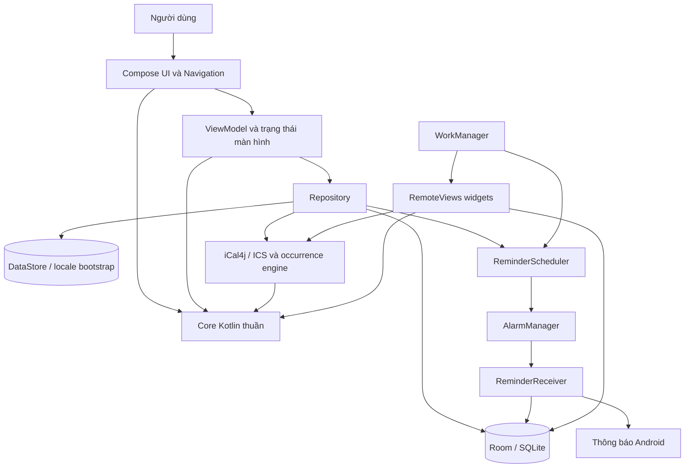

Hướng dependency ở cấp Gradle là `app → core`; `core` không biết Android, Room hoặc Compose. Các engine lịch, lá số, con giáp và phương vị có thể kiểm thử bằng JVM mà không cần emulator.

Trong `app`, giao diện được tổ chức theo chức năng và dùng các repository, DAO, engine hỗ trợ. Kiến trúc có đặc điểm MVVM và luồng trạng thái một chiều ở các màn chính: người dùng phát thao tác, ViewModel/repository cập nhật dữ liệu, Flow phát trạng thái mới và Compose vẽ lại.

Dự án chưa chia riêng các module `domain`, `data`, `presentation` hay một lớp use-case cho mọi hành động. Một số composable gọi engine thuần trực tiếp; recurrence và occurrence engine nằm trong `app`. Vì vậy, mô tả chính xác là **hai module kết hợp package theo tính năng**, với MVVM tại các luồng cần quản lý dữ liệu/lifecycle.

### 3.2. Các vai trò quan trọng

| Thành phần | Trách nhiệm | Dữ liệu đầu vào/đầu ra chính |
| --- | --- | --- |
| `MainActivity` | Locale context, Compose host, intent đầu vào, trạng thái quyền khi resume | Intent → chọn ngày/mở ICS; Flow → onboarding hoặc app |
| `CalendarViewModel` | Ngày/tháng đang xem, sự kiện, cài đặt, trạng thái editor | `SavedStateHandle`, Flow repository → `StateFlow` |
| `EventRepository` | Validation và ghi sự kiện/lời nhắc, kích hoạt cập nhật nền | `EventEntity` + offsets → ID/Room/alarm/widget |
| `AppDatabase` | Kết nối SQLite dùng chung và migration | Entity/DAO/schema |
| `EventMutationLock` | Điều phối các thao tác ghi có liên quan | Mutex trong tiến trình |
| `EventOccurrenceEngine` | Chuẩn hóa sự kiện native và ICS thành các lần xuất hiện | Sự kiện + khoảng → `EventOccurrence` |
| `ReminderScheduler` | Đồng bộ trạng thái nhắc trong Room với alarm hệ điều hành | Event/reminder row → PendingIntent/alarm |
| `HoroscopeViewModel` | Hồ sơ được chọn, tính chart, thao tác lưu/xóa/xuất | Hồ sơ → chart và trạng thái tác vụ |
| `ZodiacEngine`, `FengShuiEngine` | Phép tính truyền thống có kiểu dữ liệu rõ | Ngày, tuổi, giờ, góc → kết quả có thể giải thích |

Hilt khởi tạo `LichVietApplication`, `MainActivity`, `CalendarViewModel` và các repository có annotation tương ứng. `HoroscopeViewModel` dùng factory riêng; `IcsViewModel` dùng cơ chế Android ViewModel của chức năng ICS. `AppDatabase.get(context)` là singleton được lấy trực tiếp bởi nhiều thành phần. Dự án không áp dụng Hilt đồng nhất cho mọi lớp.

### 3.3. Nguồn sự thật của dữ liệu

Room giữ sự kiện, từng mốc nhắc và hồ sơ lá số. DataStore giữ cấu hình người dùng. Lựa chọn ngôn ngữ có lớp bootstrap riêng để Activity và worker đọc được trước khi vẽ giao diện. Kết quả lịch, occurrence và chart được tính từ đầu vào, không lưu thành nhiều bản dữ liệu độc lập.

Alarm hệ điều hành là lịch thực thi có thể bị mất sau reboot hoặc thay đổi quyền; các hàng reminder trong Room là dữ liệu bền để dựng lại alarm. Widget lấy lại dữ liệu dùng chung khi cập nhật, tránh duy trì một cơ sở dữ liệu widget riêng.

<a id="cau-truc"></a>
## 4. Tổ chức mã nguồn

```text
calendar/
├── app/
│   ├── build.gradle.kts
│   ├── proguard-rules.pro
│   ├── schemas/vn.lichviet.app.data.AppDatabase/1.json ... 4.json
│   └── src/
│       ├── main/
│       │   ├── AndroidManifest.xml
│       │   ├── java/vn/lichviet/app/
│       │   │   ├── MainActivity.kt, LichVietApplication.kt
│       │   │   ├── CalendarViewModel.kt, AppLocaleManager.kt
│       │   │   ├── data/       Room, preferences, recurrence, backup
│       │   │   ├── reminder/   Alarm, receiver, notification, worker
│       │   │   ├── ics/        Codec, preview/import/export, occurrence/layout
│       │   │   ├── horoscope/  Hồ sơ, lá số, tra cứu, xuất PNG/PDF
│       │   │   ├── zodiac/     12 con giáp, nguồn và phong thủy
│       │   │   ├── widget/     Bốn AppWidgetProvider và render RemoteViews
│       │   │   └── ui/         Theme, app shell, lịch, editor, onboarding, tools
│       │   ├── res/            Resource default/vi/en, XML widget, icon, theme
│       │   └── assets/licenses/
│       ├── test/               Kiểm thử JVM phần app
│       └── androidTest/        Room, Android services và Compose journey
├── core/
│   ├── src/main/kotlin/vn/lichviet/core/
│   │   ├── Astronomy.kt
│   │   ├── VietnameseCalendar.kt
│   │   ├── Almanac.kt
│   │   ├── horoscope/          HoroscopeModels, HoroscopeChartEngine
│   │   └── zodiac/             CulturalSources, ZodiacEngine, FengShuiEngine
│   ├── src/test/kotlin/
│   ├── README.md
│   └── HOROSCOPE_RULES.md
├── docs/                       Quy tắc, các phase, audit và báo cáo phát hành
├── artifacts/                  Báo cáo XML, ảnh QA, gói build cục bộ
├── gradle/wrapper/             Gradle wrapper được ghim
├── build.ps1                   Lệnh build/kiểm tra tiện dụng
├── device.ps1                  Thao tác emulator phục vụ QA
└── README.md, VALIDATION.md, THIRD_PARTY_NOTICES.md
```

Tại thời điểm khảo sát, phần production có **8 tệp Kotlin trong core** và **56 tệp Kotlin trong app**; có 11 tệp Kotlin kiểm thử JVM và 24 tệp Kotlin trong `androidTest`, bao gồm helper. Các số này đếm tệp nguồn, loại mã sinh trong `build`; không tương đương số test case.

Hai script PowerShell hỗ trợ môi trường phát triển Windows hiện tại. Chúng không được đóng gói vào APK. `device.ps1` phục vụ emulator có ID `emulator-5554`, vì vậy cần điều chỉnh môi trường nếu dùng thiết bị khác.

<a id="du-lieu"></a>
## 5. Thiết kế dữ liệu và migration

### 5.1. Mô hình quan hệ

Database có tên **`lich-viet.db`**, schema hiện tại **4**, gồm ba bảng nghiệp vụ. Quan hệ giữa sự kiện và các mốc nhắc là một-nhiều. Hồ sơ lá số độc lập với sự kiện.

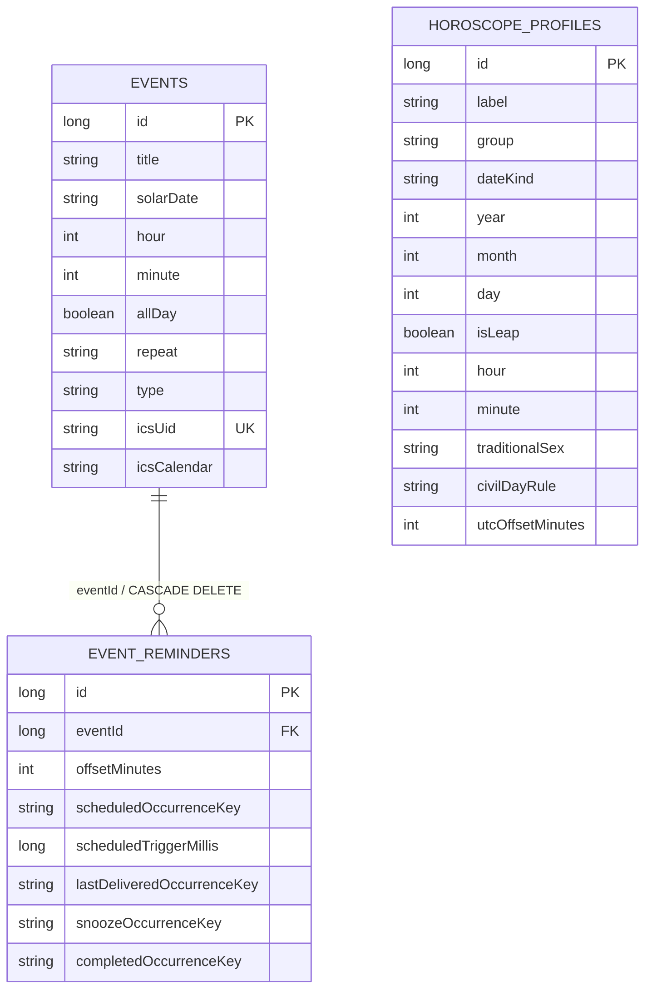

Sơ đồ rút gọn một số trường để thể hiện quan hệ. Định nghĩa đầy đủ nằm trong [EventEntity.kt](../app/src/main/java/vn/lichviet/app/data/EventEntity.kt), [EventReminderEntity.kt](../app/src/main/java/vn/lichviet/app/data/EventReminderEntity.kt) và [HoroscopeProfileEntity.kt](../app/src/main/java/vn/lichviet/app/horoscope/HoroscopeProfileEntity.kt).

### 5.2. Bảng `events`

| Nhóm | Trường | Ý nghĩa |
| --- | --- | --- |
| Định danh | `id`, `icsUid` | ID Room nội bộ; UID iCalendar ổn định để đối chiếu khi nhập/xuất |
| Nội dung | `title`, `note`, `location`, `colorArgb` | Tên, ghi chú, địa điểm, màu; màu null dùng palette theo loại |
| Bắt đầu | `solarDate`, `hour`, `minute`, `allDay` | Ngày ISO và giờ; phân biệt sự kiện cả ngày |
| Kết thúc | `endSolarDate`, `endHour`, `endMinute` | Điểm kết thúc loại trừ; null hỗ trợ sự kiện cũ không có duration |
| Phân loại/lặp | `type`, `repeat` | Sự kiện thường/sinh nhật/ngày giỗ; kiểu lặp |
| Lặp âm | `lunarDay`, `lunarMonth`, `leapMonthPolicy`, `missingDayPolicy` | Ngày/tháng neo và xử lý tháng nhuận/ngày thiếu |
| Tương thích lời nhắc cũ | `reminderDaysBefore`, `reminderEnabled` | Mốc ngày kiểu cũ và công tắc nhắc; mốc chi tiết nằm ở bảng con |
| Chuỗi nhập | `icsCalendar` | VCALENDAR canonical theo một UID để giữ quy tắc và ngoại lệ |

`icsUid` có unique index. Với sự kiện native chưa có UID, repository tạo UUID với hậu tố `@lichviet.local`. `EventDao.save()` chọn insert hoặc update theo ID; không dùng `REPLACE` cho bản ghi sự kiện đã tồn tại, vì thao tác thay thế có thể xóa bản ghi cha và kéo theo cascade các reminder ID đang dùng bởi PendingIntent.

Validation giới hạn title 200 ký tự, note 4.000 ký tự, location 500 ký tự, UID 512 ký tự; giờ/phút trong phạm vi hợp lệ. Màu tùy chọn phải có alpha đầy đủ. Thời lượng tối đa 366 ngày và kết thúc phải sau bắt đầu khi khai báo duration. Canonical ICS trong entity bị giới hạn 4.000.000 ký tự. Các giới hạn nhập ICS ở cấp tệp được kiểm tra riêng.

### 5.3. Bảng `event_reminders`

Mỗi dòng là một mốc nhắc với `offsetMinutes` tính trước thời điểm neo. Có index `eventId` và unique index `(eventId, offsetMinutes)`. Xóa sự kiện tự xóa các dòng con bằng khóa ngoại; code đồng thời hủy alarm và notification tương ứng.

Các nhóm trường phản ánh vòng đời mốc nhắc:

| Nhóm | Các trường | Vai trò |
| --- | --- | --- |
| Định danh | `id`, `eventId`, `offsetMinutes` | Giữ reminder ID ổn định khi sửa các mốc không thay đổi |
| Đã lên lịch | `scheduledDate`, `scheduledOccurrenceKey`, `scheduledTriggerMillis` | Lần xuất hiện và thời điểm mà alarm phải phát |
| Đã giao | `lastDeliveredDate`, `lastDeliveredOccurrenceKey`, `lastDeliveredTriggerMillis` | Chống phát lại cùng lần và cùng trigger |
| Đang hoãn | `snoozeDate`, `snoozeOccurrenceKey`, `snoozeUntilMillis` | Phục hồi hành động snooze |
| Hoàn thành | `completedDate`, `completedOccurrenceKey` | Bỏ qua occurrence đã hoàn thành |

Occurrence key cần thiết vì ICS có thể có nhiều lần xuất hiện hoặc ngoại lệ trong cùng ngày. Chỉ dùng ngày làm khóa sẽ không phân biệt được chúng. Các trường `...Date` vẫn được giữ để tương thích dữ liệu và giao diện cũ.

### 5.4. Bảng `horoscope_profiles`

Hồ sơ lưu **đầu vào của lá số**, gồm biệt danh, nhóm `SELF/FAMILY/FRIEND`, kiểu ngày `SOLAR/LUNAR`, năm/tháng/ngày, cờ nhuận, giờ/phút, tham số giới tính lịch sử, quy ước đổi ngày và offset 420 phút. Các chuỗi/enum được kiểm tra trước khi lưu hoặc nhập backup.

Chart không được lưu nguyên dạng vào Room. Khi chọn hồ sơ, hệ thống tính lại chart với rule-set hiện có. Thiết kế này tránh việc lưu một kết quả cũ rồi hiển thị như thể được tính bởi quy tắc mới. Đổi lại, việc nâng quy tắc trong tương lai cần có chính sách version hóa và thông báo thay đổi kết quả.

### 5.5. Migration

| Bước | Thay đổi | Cách giữ dữ liệu |
| --- | --- | --- |
| 1 → 2 | Thêm `allDay` và bảng `event_reminders` | Chuyển mốc nhắc cũ từ số ngày sang phút ở bảng con |
| 2 → 3 | Thêm end/location/color/UID/canonical ICS và occurrence key | Tạo UID cho sự kiện cũ; khởi tạo key từ trường ngày cũ |
| 3 → 4 | Thêm `horoscope_profiles` | Giữ nguyên các bảng sự kiện/lời nhắc |
| 1.0.1 → 1.1.0 | Không đổi schema 4 | Con giáp/phong thủy tra nhanh không cần thêm bảng |

Room đăng ký migration rõ ràng, không dùng destructive migration. Schema JSON từ 1 đến 4 được lưu trong [app/schemas](../app/schemas). Việc mở lại các phiên bản schema được kiểm tra trong instrumentation test; kết quả cụ thể trình bày ở mục kiểm thử.

### 5.6. DataStore, locale và trạng thái tạm

DataStore `preferences` chứa `theme`, `show_lunar`, `show_holidays`, `monday_first`, `show_week_numbers`, `show_auspicious_hours`, `animations_enabled` và `onboarding_completed`. Repository bắt `IOException` khi đọc để phát cấu hình mặc định; các lỗi khác được truyền tiếp.

Ngôn ngữ không nằm chung bản `UserPreferences`: `AppLocaleManager` dùng framework per-app locale từ API 33 và SharedPreferences `locale_bootstrap` để bootstrap/làm nhánh tương thích. `SavedStateHandle` và `rememberSaveable` giữ ngày đang xem, tab, editor hoặc tham số tra cứu qua recreation; chúng không thay thế lưu trữ hồ sơ dài hạn trong Room.

<a id="giao-dien"></a>
## 6. Quản lý trạng thái và thiết kế giao diện

### 6.1. Luồng trạng thái

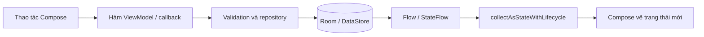

`CalendarViewModel` lấy ngày/tháng/tuần đang xem từ `SavedStateHandle`, chuyển thành Flow và ghép với các Flow sự kiện/cài đặt. Nhiều luồng dùng `stateIn(..., SharingStarted.WhileSubscribed(5000), ...)`; trạng thái onboarding dùng nhánh eager để phục vụ quyết định màn khởi động. UI thu thập bằng `collectAsStateWithLifecycle` để phối hợp với vòng đời Activity.

Trạng thái editor có `running`, `completed`, `requestNotifications`, `error`. Khi đang lưu hoặc xóa, lời gọi lặp được chặn; khi thành công, UI đóng editor và có thể xin quyền thông báo. Lỗi được ánh xạ thành resource để hiển thị. Coroutine cancellation được truyền lại ở các khối bắt lỗi chính thay vì coi hủy tác vụ là lỗi người dùng.

Trạng thái nhỏ của màn như tab, bật bảng từng ngày và nội dung nhập sử dụng `rememberSaveable`. Cụm Tử Vi có `SaveableStateHolder` để giữ trạng thái giữa ba tab con. `HoroscopeViewModel` dùng `mapLatest` tính chart khi hồ sơ thay đổi, nhờ đó có thể hủy phép tính cũ khi chọn hồ sơ mới.

### 6.2. Màn hình và điều hướng

Có năm destination chính: `calendar`, `auspicious`, `horoscope`, `events`, `settings`. Hai màn công cụ `converter` và `holidays` mở từ lịch và có nút quay lại. Điều hướng chính dùng `launchSingleTop`, `saveState` và `restoreState` để hạn chế tạo màn trùng và phục hồi trạng thái.

`HoroscopeScreen` có ba tab: 12 con giáp, lá số, phong thủy. Chọn một ngày trong bảng dự báo hoặc công cụ tra cứu gọi callback `model.select(date)` rồi điều hướng về lịch. Cách này dùng chung ngày được chọn của ứng dụng thay vì tạo một màn lịch độc lập cho mỗi chức năng.

### 6.3. Bố cục theo cửa sổ và cỡ chữ

| Vùng UI | Quy tắc trong mã nguồn |
| --- | --- |
| Điều hướng toàn app | Window width class Expanded dùng Navigation Rail; cửa sổ hẹp dùng NavigationBar |
| Độ rộng rail | Tăng theo `fontScale`, cơ sở 92 dp |
| Lịch và chi tiết | Hai cột khi bề rộng khả dụng đạt `760 × max(fontScale, 1)` dp |
| Lưới lịch | Duy trì độ rộng tối thiểu theo font; có cuộn ngang khi cửa sổ không đủ |
| Dashboard con giáp | Từ 700 dp dùng 4 cột; phone chữ lớn từ 1,5 dùng 2 cột; còn lại 3 cột |
| Workspace lá số | Bố cục hai vùng từ 900 dp trong vùng chức năng |
| Toàn màn hình | Trên bố cục rail có thể ẩn system bars; khôi phục khi thoát/dispose |

Các quyết định dựa trên kích thước khả dụng và cỡ chữ, không chỉ kiểm tra loại thiết bị là điện thoại hay tablet. Giao diện sử dụng `safeDrawingPadding`, edge-to-edge và `adjustResize` để phối hợp system bars/bàn phím.

### 6.4. Theme, ngôn ngữ và nội dung

Theme có ba lựa chọn hệ thống/sáng/tối. Animation có thể tắt; navigation fade được điều khiển theo lựa chọn này. Màu sự kiện có palette theo loại và hỗ trợ mã màu được validation.

Nội dung hiển thị dùng resource default, `values-vi`, `values-en`; ánh xạ các ID nghiệp vụ qua `CalendarText`, `HoroscopeText` và `ZodiacText`. Cách tách ID khỏi nhãn cho phép cache dữ liệu tính toán dùng chung giữa các ngôn ngữ. AAB tắt language split để giữ cả VI và EN phục vụ đổi ngôn ngữ offline sau cài đặt.

Đợt kiểm chứng 1.1.0 ghi nhận 626 tên string/plural/array ở mỗi bộ resource. Số lượng bằng nhau chứng minh tên resource đủ giữa các bộ; nó chưa đánh giá toàn bộ chất lượng dịch, phát âm TalkBack hoặc mọi tình huống tràn chữ.

<a id="khoi-dong"></a>
## 7. Luồng khởi động và tiếp nhận intent

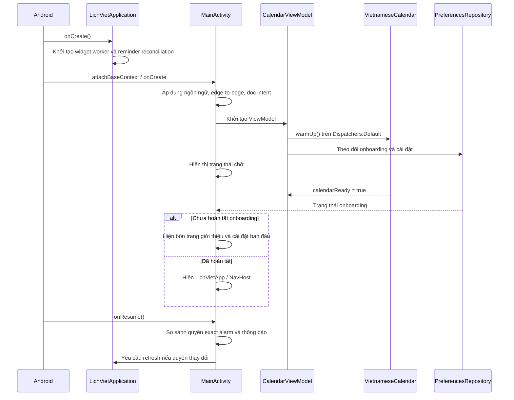

`Application` tạo notification channel, đăng ký công việc đối soát nhắc định kỳ và cập nhật widget. `CalendarViewModel` chuẩn hóa ngày/tháng khôi phục vào phạm vi hỗ trợ, đồng thời làm ấm bảng lịch ở background. Activity chờ đủ thông tin onboarding và calendar-ready trước khi vẽ màn chính.

Intent có extra `selected_date` được parse rồi chuyển vào `model.select`; đây là đường vào từ widget và thông báo. Intent `ACTION_VIEW` với scheme `content` hoặc `file` được chuyển sang luồng xem trước ICS. `onNewIntent` sử dụng lại xử lý này. ICS chỉ được ghi vào Room sau bước preview và lựa chọn nhập của người dùng.

<a id="lich-am-duong"></a>
## 8. Lịch âm dương và quy ước thời gian

### 8.1. Mô hình ngày và mốc thời gian

`LunarDate(day, month, year, isLeap)` lưu riêng cờ tháng nhuận; ngày 1 tháng 2 thường khác ngày 1 tháng 2 nhuận. Các ID như `CanChiId`, `SolarTermId`, `HolidayId`, `AuspiciousHourId` biểu diễn kết quả trước khi dịch ra nhãn.

| Vấn đề | Quy ước triển khai |
| --- | --- |
| Dải ngày dương | 1900-01-01 đến 2100-12-31, bao gồm hai đầu |
| Kinh tuyến tính lịch âm | UTC+7 cố định, không lấy timezone hiện tại của thiết bị để dựng tháng |
| Ngày hiện tại trong ứng dụng | Lấy theo `Asia/Ho_Chi_Minh`, sau đó giới hạn vào dải hỗ trợ nếu cần |
| Lịch trước 1968 | Hồi tố quy tắc UTC+7 hiện đại; chưa tái dựng lịch sử từng miền |
| Tiết khí hiển thị | Tiết đang có tại trưa UTC+7; không công bố giờ chuyển tiết chính xác |
| Đầu năm con giáp | Tết của năm âm Việt Nam |
| Đổi ngày khi lập giờ/lá số | Có lựa chọn 00:00 hoặc phần 23:00 của giờ Tý sang ngày kế |
| Khoảng sự kiện | Bắt đầu bao gồm, kết thúc loại trừ: `[start, end)` |
| Khoảng tìm ngày tốt | Bao gồm ngày đầu và cuối, tối đa 367 ngày |

Giữa module thiên văn và API thời gian Android có khác biệt cần bảo toàn: bảng tháng âm dựng bằng offset +07:00 cố định; việc lấy hiện tại/lên lịch sự kiện native dùng `ZoneId Asia/Ho_Chi_Minh`. Dự án không cam kết tái dựng wall-clock lịch sử Việt Nam từ các offset vùng trước đây. ICS giữ timezone nguồn và quy đổi về vùng hiển thị của ứng dụng.

### 8.2. Dựng tháng âm từ thiên văn

`Astronomy` triển khai thời điểm sóc, kinh độ Mặt Trời, đông chí và ước lượng TT−UT. Bảng tháng trong `VietnameseCalendar` được sinh một lần bằng lazy initialization, có mở rộng các năm đệm 1898–2101 để bao kín biên ngày cần dùng.

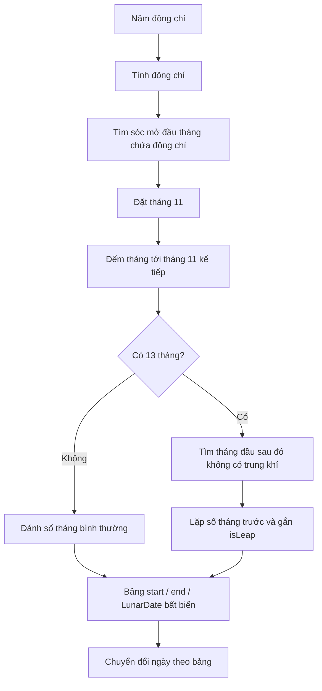

Tháng có đông chí là tháng 11. Nếu giữa hai tháng 11 có 13 tháng, tháng đầu tiên sau đó không chứa trung khí là tháng nhuận và lặp số tháng trước. Việc xét trung khí theo ngày dân dụng tại biên tháng xử lý các trường hợp đặc biệt như tháng 11 nhuận năm 2033.

`solarToLunar` tìm tháng chứa ngày bằng tìm kiếm nhị phân rồi cộng độ lệch ngày. `lunarToSolar` hiện tìm tuyến tính tháng có cùng năm/tháng/cờ nhuận, kiểm tra ngày không vượt cuối tháng và kết quả nằm trong phạm vi. Vì bảng chỉ có vài nghìn tháng, thiết kế này gọn; nếu tăng nhiều lần khối lượng tra cứu âm→dương, có thể bổ sung index theo khóa tháng.

### 8.3. Cache và xử lý dữ liệu ngày

`dayData` dùng LRU tối đa **512 ngày**, được bảo vệ bằng `synchronized`. Cache chứa ngày âm và các holiday ID; nhãn VI/EN được tạo ngoài cache. Cùng một dữ liệu ngày được tái sử dụng khi render lưới, chi tiết và widget. Cache chỉ nằm trong RAM và được tạo lại khi tiến trình khởi động.

### 8.4. Can Chi, tiết khí, giờ và ngày lễ

Can Chi ngày được suy ra từ số ngày Julian; Can Chi năm từ năm âm; Can Chi tháng từ năm/tháng âm. Năm 1899 được chấp nhận ở đầu vào âm khi kết quả còn nằm trong tháng 1/1900 dương, để toàn bộ dải ngày dương có thể chuyển đổi hai chiều.

Giờ hoàng đạo trả sáu giờ kép theo ngày. Holiday ID bao gồm ngày lễ dương, lễ âm, mùng một, rằm và Giao thừa. Danh sách ngày lễ được gắn với ngày tính toán; UI/widget dùng chung các ID này để dịch và trình bày.

### 8.5. Tra ngày theo mục đích

`Almanac` tách khỏi phép dựng lịch thiên văn. Nó áp dụng bộ quy ước được công bố: xét nhóm chi hoàng đạo của tháng âm, tính 12 trực theo tháng tiết khí, ưu tiên trực theo bốn mục đích, loại các ngày Tam Nương/Nguyệt Kỵ. Kết quả trả cờ đề xuất và danh sách lý do có kiểu.

Đây là bộ chọn ngày văn hóa được đơn giản hóa. Nó không lấy ngày sinh để chấm điểm cá nhân và không mô hình hóa toàn bộ hệ thống Thông thư. Thuật toán duyệt từng ngày trong khoảng tối đa 367 ngày; từng kết quả có thể mở lại trên lịch chính.

Nguồn, sai số và fixture độc lập được mô tả chi tiết tại [core/README.md](../core/README.md). Một số phép so sánh trong bộ test đo được chênh lệch thời gian thiên văn; chúng không tạo thành bảo đảm sai số đồng nhất cho mọi ngày trong 201 năm.

<a id="su-kien"></a>
## 9. Sự kiện, lặp và bố trí lịch

### 9.1. Lưu hoặc sửa sự kiện

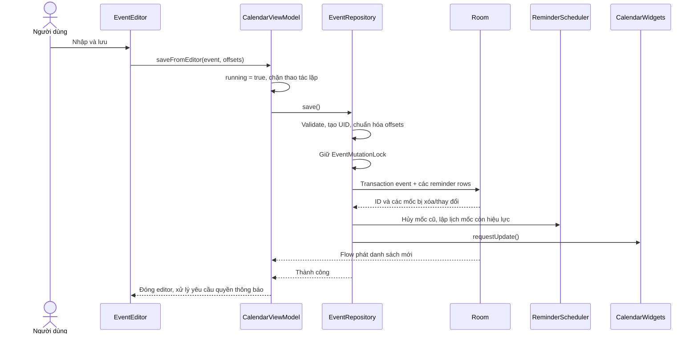

Repository phối hợp transaction Room với mutex dùng chung. Những mốc giữ nguyên offset được giữ ID; mốc bị bỏ được xóa và hủy alarm. Khi các trường ảnh hưởng lịch nhắc đổi, trạng thái reminder được reset. Ghi dữ liệu và lập lịch nằm trong vùng `NonCancellable` để giảm trường hợp UI bị đóng khiến tác vụ dở giữa chừng. Đây vẫn là phối hợp giữa SQLite và hệ điều hành, không có transaction phân tán nguyên tử bao trùm cả Room và AlarmManager; công việc đối soát là lớp phục hồi.

### 9.2. Tính lặp native

`Recurrence.nextOccurrence` trả ngày xuất hiện tiếp theo từ một mốc bao gồm. Nó không tìm trước ngày neo và không trả kết quả ngoài dải hỗ trợ.

| Kiểu | Cách tính |
| --- | --- |
| `NONE` | Trả ngày neo nếu chưa qua |
| `DAILY` | Ngày bắt đầu tìm hợp lệ |
| `WEEKLY` | Làm tròn số tuần từ ngày neo |
| `MONTHLY` | Duyệt các tháng, giữ ngày neo hoặc áp dụng chính sách ngày thiếu |
| `YEARLY` | Duyệt năm, giữ tháng/ngày neo hoặc xử lý ngày không tồn tại |
| `LUNAR_YEARLY` | Chuyển ngày/tháng âm trong từng năm về dương; xét tháng thường/nhuận/cả hai |

`MissingDayPolicy.LAST_DAY` dời về cuối tháng khi ngày neo không có; `SKIP` bỏ lần đó. Với ngày âm 30 trong tháng chỉ có 29 ngày, nhánh LAST_DAY thử ngày 29 của đúng tháng và cờ nhuận đang xét. `LeapMonthPolicy` cho phép thường, nhuận hoặc cả hai; không tự biến một tháng nhuận không tồn tại thành tháng thường.

### 9.3. Chuẩn hóa thành occurrence

`EventOccurrence` gồm bản sự kiện gốc, `occurrenceKey`, `start`/`endExclusive` dạng Instant, khoảng ngày hiển thị, title/note/location và thuộc tính trình bày. `EventOccurrenceEngine` mở rộng cả native và ICS thành mô hình này.

Lịch tháng yêu cầu một cửa sổ 42 ngày, lịch tuần 7 ngày. Các instance chồng lên cửa sổ, kể cả sự kiện đã bắt đầu từ trước, được đưa vào vùng hiển thị theo logic của engine. Widget sắp tới dùng cùng occurrence để giữ đúng title của ngoại lệ ICS và sự kiện nhiều ngày đang diễn ra.

Một lần `between` bị giới hạn cửa sổ tối đa 367 ngày. Engine còn đặt ngưỡng occurrence 20.000 cho các nhánh xử lý recurrence liên quan để giới hạn công việc. Không nên coi ngưỡng này là một cơ chế phân trang database hoặc cam kết hiệu năng với mọi tệp ICS ở sát giới hạn.

### 9.4. Thanh nhiều ngày và tràn hàng

`EventLayoutEngine.week` cắt khoảng sự kiện tại hai đầu tuần, sắp xếp ổn định theo ngày bắt đầu, độ dài, ID và key, rồi dùng thuật toán tham lam để chọn lane trống sớm nhất. Thanh có cờ bắt đầu/kết thúc để biểu diễn phần nối qua tuần.

Số lane hiển thị mặc định là 2, đầu vào được giới hạn 1–8. Nếu hết chỗ, engine đếm số sự kiện bị ẩn theo từng ngày để UI hiện overflow. Quy tắc kết thúc loại trừ được dùng xuyên suốt: sự kiện cả ngày từ 23/10 đến 25/10 chỉ chiếm 23 và 24/10.

<a id="loi-nhac"></a>
## 10. Hệ thống lời nhắc

### 10.1. Phân công giữa AlarmManager và WorkManager

`AlarmManager` phụ trách đánh thức thành phần phát lời nhắc. `WorkManager` chạy đối soát dữ liệu bền trong Room với alarm, và yêu cầu cập nhật widget. Việc phát lời nhắc không được đặt lên một periodic worker với kỳ vọng chạy chính xác vào giờ người dùng chọn.

`ReminderScheduler.initialize` tạo kênh thông báo, đăng ký công việc `calendar-reminder-reconcile` chu kỳ 12 giờ bằng chính sách KEEP, và yêu cầu đối soát ngay qua unique work `calendar-refresh` với chính sách REPLACE. Worker tương thích cũ `EventReminderWorker` trả thành công mà không phát nhắc để các WorkRequest của phiên bản rất cũ không gây giao trùng sau nâng cấp.

### 10.2. Từ mốc nhắc đến alarm

Một sự kiện hỗ trợ tối đa 16 offset riêng biệt, từ 0 đến 525.600 phút, tương ứng tối đa 365 ngày trước. `ReminderPlanner` tìm occurrence kế tiếp và trừ offset để tạo thời điểm trigger. Với **sự kiện native cả ngày**, giờ neo nhắc là 09:00 giờ Việt Nam; sự kiện có giờ dùng giờ đã nhập. Các chuỗi ICS sử dụng thời điểm bắt đầu occurrence do ICS xác định.

PendingIntent dùng URI riêng theo reminder ID và loại `fire`/`snooze-fire`, kèm cờ immutable. Chi tiết ngày, occurrence key và trigger được truyền trong extras, sau đó được đối chiếu lại với Room khi nhận broadcast. ID ổn định giúp sửa sự kiện hoặc hủy một mốc không làm ảnh hưởng mốc khác.

| Điều kiện | Cách lên lịch |
| --- | --- |
| Được phép exact alarm | `setExactAndAllowWhileIdle(RTC_WAKEUP, ...)` |
| Chưa được phép | `setAndAllowWhileIdle(...)`, chấp nhận nhánh inexact |
| Quyền bị thu hồi giữa lúc kiểm tra và gọi API | Bắt `SecurityException` rồi chuyển sang inexact |
| Không còn occurrence hợp lệ | Xóa thông tin scheduled tương ứng và không tạo alarm mới |

Quyền thông báo và special access exact alarm là hai điều kiện khác nhau. UI chỉ yêu cầu quyền thông báo ở tình huống người dùng bật chức năng liên quan; truy cập exact alarm được điều hướng qua cài đặt Android. `onResume` so sánh quyền để yêu cầu đối soát nếu trạng thái thay đổi.

### 10.3. Giao lời nhắc và chống trùng

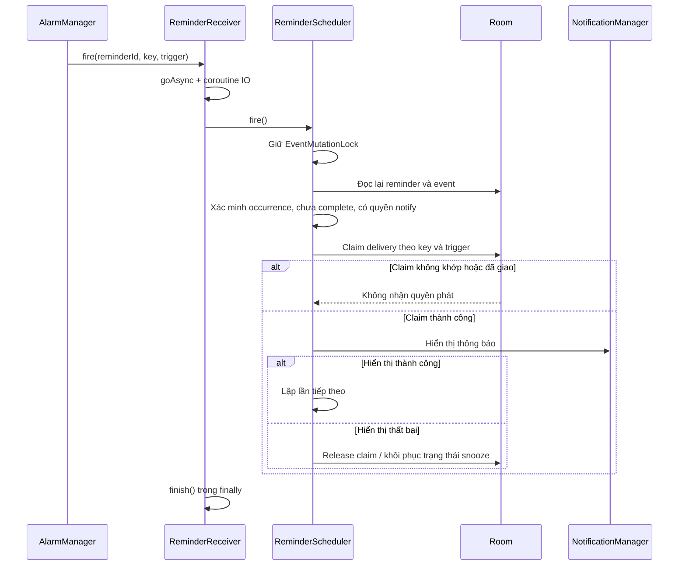

Các câu lệnh claim trong DAO cập nhật có điều kiện và kiểm tra số hàng bị tác động. Một broadcast cũ, sai trigger hoặc đã giao sẽ không tự được chấp nhận chỉ vì chứa đúng ID. Khi người dùng sửa/xóa sự kiện, dữ liệu Room hiện tại được kiểm tra lại trước khi phát.

Claim trong database và thao tác hiển thị notification vẫn là hai hành động riêng. Thiết kế có khôi phục khi lời gọi hiển thị báo thất bại và có đối soát, nhưng không nên mô tả là bảo đảm “đúng một lần” tuyệt đối trong mọi thời điểm process bị chấm dứt hoặc mất nguồn.

### 10.4. Hoãn và hoàn thành

Thông báo cho phép chọn hoãn 5, 10 hoặc 15 phút. Trạng thái snooze được lưu vào reminder row để có thể dựng lại sau biến động hệ thống. Hành động chỉ hợp lệ nếu key khớp occurrence đã giao và chưa hoàn thành.

Khi hoàn thành, DAO đánh dấu occurrence cho các mốc của cùng sự kiện, hủy alarm/notification tương ứng rồi lên lịch lần kế tiếp. Cách này xử lý theo **lần xuất hiện**, giữ chuỗi lặp cho các lần sau.

### 10.5. Phục hồi và giới hạn giao nhận

`CalendarRefreshReceiver` nhận reboot, app replacement, đổi ngày, đổi giờ và đổi timezone; nó yêu cầu refresh rồi cập nhật widget. Đổi quyền exact alarm cũng có nhánh xử lý. Trong đối soát, alarm inexact quá giờ chưa giao được giữ lại nếu vẫn đúng occurrence/trigger và không quá cửa sổ phục hồi 24 giờ; snooze cũ cũng có ngưỡng dọn tương ứng.

Hệ điều hành có thể trì hoãn inexact alarm và worker trong Doze/tiết kiệm pin. Khi máy tắt, ứng dụng bị force-stop, thông báo bị chặn hoặc điều kiện OEM cản chạy nền, việc giao không được bảo đảm. Các giới hạn này thuộc điều kiện vận hành thực tế, dù trạng thái ứng dụng đã được lưu bền.

Mã và quyết định triển khai chi tiết: [ReminderScheduler.kt](../app/src/main/java/vn/lichviet/app/reminder/ReminderScheduler.kt), [ReminderPlanner.kt](../app/src/main/java/vn/lichviet/app/reminder/ReminderPlanner.kt), [PHASE1_REMINDERS.md](PHASE1_REMINDERS.md).

<a id="ics"></a>
## 11. Nhập và xuất iCalendar/ICS

### 11.1. Các lớp của chức năng

| Lớp | Nhiệm vụ |
| --- | --- |
| `IcsWorkspace` | Chọn tệp, xem preview, chọn cách xử lý UID, xuất/chia sẻ |
| `IcsViewModel` | Trạng thái busy, preview, lựa chọn, thông báo và share URI |
| `IcsRepository` | Đọc URI, kiểm tra dữ liệu hiện tại và giao dịch nhập |
| `IcsCodec` | Đổi giữa văn bản ICS và mô hình preview/canonical; xuất native extension |
| `IcsSupport` | Parse, kiểu thời gian, timezone, duration, phát hiện tính năng không hỗ trợ |
| `EventOccurrenceEngine` | Mở rộng master/ngoại lệ thành các occurrence thực |

`iCal4j` đảm nhận mô hình và parser iCalendar; mã dự án bổ sung các ràng buộc sản phẩm và Android. Việc sử dụng thư viện chuẩn ICS không đồng nghĩa ứng dụng hỗ trợ toàn bộ RFC hoặc toàn bộ biến thể của mọi phần mềm lịch.

### 11.2. Luồng nhập

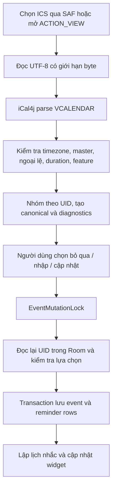

Preview hiển thị lỗi và cảnh báo theo từng UID. Diagnostics có mã để UI ánh xạ resource, thay vì chỉ phụ thuộc câu tiếng Anh từ thư viện. Repository kiểm tra lại UID lúc áp dụng, vì giữa preview và import dữ liệu có thể đã thay đổi. Một lựa chọn IMPORT khi UID đã tồn tại hoặc UPDATE khi UID không còn sẽ bị từ chối, tránh ghi đè nhầm.

### 11.3. Giữ ý nghĩa chuỗi và timezone

Chuỗi nhập lưu một VCALENDAR canonical theo UID trong `icsCalendar`, gồm master và các ngoại lệ liên quan. Khi xuất lại, các phần được giữ có thể đi theo nội dung gốc, thay vì ép chuỗi ngoại lai thành một kiểu lặp native đơn giản.

Hỗ trợ có kiểm tra cho các trường ngày/giờ, timezone, RRULE trong phạm vi, RDATE, EXDATE và ngoại lệ RECURRENCE-ID. Timezone UTC/TZID được chuyển thành Instant; floating time dùng vùng hiển thị của ứng dụng theo quy ước hiện tại.

Với VTIMEZONE nhúng, Android không cung cấp cơ chế đăng ký tùy ý mọi ZoneRulesProvider. Dự án dựng quy tắc nhúng để so sánh với timezone nền tảng trong 1900–2100, có xét các lần chuyển offset. Custom TZID không nhận diện hoặc định nghĩa khác lịch sử của nền tảng bị từ chối; ứng dụng không âm thầm thay bằng timezone có cùng tên nhưng khác nghĩa.

### 11.4. Giới hạn đầu vào và tính năng

| Nội dung | Giới hạn/hành vi |
| --- | --- |
| Đọc tệp | Tối đa `4 × 1024 × 1024` byte ở repository |
| Văn bản parse | Tối đa `4 × 1024 × 1024` ký tự ở codec |
| VEVENT / UID / ngoại lệ | 10.000 VEVENT, 5.000 UID, 500 override theo các ngưỡng codec |
| Duration | Không âm, tối đa 366 ngày |
| Cửa sổ mở rộng | Tối đa 367 ngày cho một lời gọi `between` |
| Lặp dưới một ngày | SECONDLY/MINUTELY/HOURLY bị từ chối |
| `EXRULE` | Bị từ chối |
| `RECURRENCE-ID;RANGE` | Bị từ chối |
| VALARM | Chỉ một tập mốc trước thời điểm bắt đầu được đưa vào scheduler; các kiểu khác có cảnh báo và có thể được giữ để xuất lại |
| VALARM riêng ở override | Được giữ, chưa được lên lịch riêng theo instance |
| Chỉnh sửa ngoại lệ | Chưa có editor riêng cho từng occurrence ICS |
| Đồng bộ | Nhập/xuất tệp; chưa có subscription, CalDAV hoặc tài khoản lịch |

Các giới hạn byte, ký tự và số lượng là những kiểm tra khác nhau, không nên đồng nhất thành một mức dung lượng duy nhất cho mọi bước. Backup cũng kiểm tra canonical bằng codec trước khi nhập vào database.

### 11.5. Xuất và chia sẻ

Người dùng có thể xuất một, nhiều hoặc tất cả sự kiện. Sự kiện native được mã hóa thành VEVENT; kiểu lặp âm dùng `X-LICHVIET-*` để giữ thông tin riêng và một tập ngày hữu hạn để ứng dụng lịch khác có thể hiển thị. Khi nhập lại, extension được kiểm tra tính nhất quán trước khi khôi phục thành native.

Chia sẻ tạo tệp trong `cache/ics`, cấp content URI qua FileProvider và dùng Sharesheet. Lưu trực tiếp dùng URI do trình chọn tệp Android cung cấp. Tệp chia sẻ cũ hơn một ngày được dọn ở lần xuất sau; đây là dọn theo thao tác, không có một job cam kết xóa đúng sau 24 giờ.

Chi tiết tập tương thích: [PHASE2_ADVANCED_CALENDAR.md](PHASE2_ADVANCED_CALENDAR.md).

<a id="la-so"></a>
## 12. Lá số Tử Vi Đẩu Số

### 12.1. Dữ liệu, quy tắc và tính toán

Calculation engine ở `core.horoscope` tách khỏi UI. Rule-set có ID **`ming-nanyangtang-ziwei-quanshu-vol3-v1`**, chọn một ấn bản cụ thể của *Tử Vi Đẩu Số Toàn Thư* và ghi rõ các quy tắc/cách hiệu đính sử dụng. Không trộn ngầm các bảng khác trường phái khi nguồn đã chọn có khác biệt.

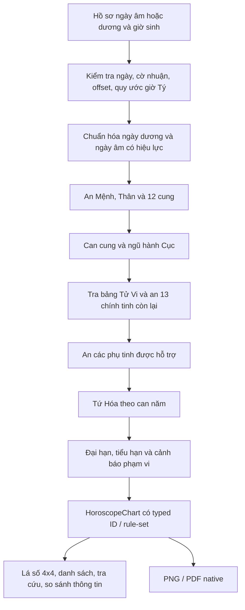

### 12.2. Phạm vi an sao đã triển khai

| Khối | Cách triển khai và quy ước |
| --- | --- |
| Mệnh/Thân | Đếm tháng và giờ theo quy tắc ấn bản; tháng nhuận được tính sang tháng kế cho phép an này |
| 12 cung | Vai trò cung di chuyển theo thứ tự và chiều đã công bố |
| Cục | Từ can-chi cung Mệnh và nạp âm, ánh xạ Thủy 2/Mộc 3/Kim 4/Thổ 5/Hỏa 6 |
| 14 chính tinh | Tử Vi từ bảng 5 Cục × 30 ngày; các chính tinh khác theo offset/quan hệ đã chọn |
| Phụ tinh | Tập được hỗ trợ gồm Văn Xương/Văn Khúc, Tả Phù/Hữu Bật, Thiên Mã, Lộc Tồn, Kình Dương/Đà La, Thiên Không/Địa Kiếp |
| Tứ Hóa | Theo mười hàng can năm của ấn bản; giữ khác biệt các hàng Canh/Nhâm |
| Đại hạn | Tuổi khởi theo Cục; chiều theo âm/dương và tham số giới tính lịch sử |
| Tiểu hạn | Mốc tuổi một theo nhóm chi; chiều theo quy tắc riêng của nguồn |

Tuổi trong API đại hạn/tiểu hạn là tuổi đếm truyền thống bắt đầu từ 1; engine không tự suy tuổi từ ngày hôm nay. Tham số giới tính ở đây phục vụ thuật toán lịch sử của bộ quy tắc.

### 12.3. Tháng nhuận và phần chưa đủ nguồn

Nguồn được chọn không xác định rõ cách an Tả Phù/Hữu Bật trong tháng nhuận. Engine bỏ placement của hai sao này khi gặp ca đó và phát cờ `LEAP_MONTH_AUXILIARY_PLACEMENT`. Nếu Tứ Hóa trỏ đến sao chưa có vị trí, kết quả giữ target có kiểu và branch null.

Các phần như độ sáng sao, nhiều phụ tinh khác, giờ mặt trời, lịch sử vùng và luận đoán sự kiện đời sống chưa được triển khai trong rule-set này. Tên Thiên Không được giữ theo đúng sao `TIAN_KONG` của nguồn; việc đổi tên sang quy ước khác có thể làm sai ý nghĩa an sao.

### 12.4. UI và xuất tài liệu

Hồ sơ được lưu qua repository; ViewModel tính chart trên `Dispatchers.Default`. Màn lá số có dạng 4×4, chọn cung, zoom/pan và dạng danh sách; hỗ trợ tra tên cung/sao và xem dữ liệu giữa các hồ sơ. So sánh ở đây là so sánh thông tin tính toán đang có.

`ChartExporter` vẽ trực tiếp bằng Android Canvas: PNG kích thước 1600×2900 pixel, PDF hai trang 595×842 point. Dữ liệu không gửi tới dịch vụ render bên ngoài. File được tạo trong `cache/horoscope`; người dùng xác nhận việc xuất/chia sẻ dữ liệu cá nhân rồi mới lưu qua SAF hoặc chia sẻ bằng FileProvider.

Về kiểm chứng, có fixture nguồn từng phần và test các bảng/công thức/biên đầu vào. Chưa có một full-chart golden độc lập, đầy đủ, đối chiếu toàn bộ lá số theo đúng ấn bản. Vì vậy báo cáo không kết luận toàn bộ chart đã được chứng thực độc lập chỉ từ những test hiện có.

Nguồn và các hiệu đính: [HOROSCOPE_RULES.md](../core/HOROSCOPE_RULES.md). Tổ chức UI/persistence/export: [PHASE4_HOROSCOPE.md](PHASE4_HOROSCOPE.md).

<a id="con-giap"></a>
## 13. 12 con giáp và dự báo theo chu kỳ

### 13.1. Mô hình nghiệp vụ của v1.1.0

`ZodiacSign` có 12 giá trị theo thứ tự địa chi: Tý, Sửu, Dần, Mão, Thìn, Tỵ, Ngọ, Mùi, Thân, Dậu, Tuất, Hợi. Biểu tượng dùng **Trâu và Mèo** theo Việt Nam. Hành địa chi và âm/dương được lưu/tính riêng với nạp âm năm.

`NapAm` chứa 30 cặp nạp âm theo thứ tự vòng 60 can-chi. `cycleIndex` kiểm tra can/chi đúng phạm vi và cùng chẵn-lẻ trước khi tìm vị trí; `napAm` lấy chỉ số vòng chia hai. Một địa chi có năm tổ hợp can hợp lệ trong vòng 60 năm; UI hiển thị đủ năm biến thể và các nhãn năm âm 1899–2100.

`birthFacts(solarDate)` chuyển ngày sinh sang lịch âm rồi lấy **năm âm** để xác định tuổi và nạp âm. Ví dụ 16/02/2026 vẫn thuộc năm Ất Tỵ; 17/02/2026 mới sang Bính Ngọ. Danh sách nhãn năm không thể thay thế bước chuyển đổi ngày sinh quanh Tết.

### 13.2. Các bảng quan hệ

| Quan hệ | Cách xác định |
| --- | --- |
| Cùng chi | Hai `ZodiacSign` trùng nhau |
| Lục hợp | Bảng sáu cặp: Tý–Sửu, Dần–Hợi, Mão–Tuất, Thìn–Dậu, Tỵ–Thân, Ngọ–Mùi |
| Cùng nhóm tam hợp | Các chi có cùng phần dư khi chia chỉ số cho 4; trả hai tuổi cùng nhóm |
| Lục xung | Hai chỉ số chi cách nhau 6 trong vòng 12 |
| Thông thường | Các cặp còn lại trong phạm vi mô hình |

Hai thành viên cùng nhóm được gọi là bạn đồng nhóm tam hợp; ứng dụng không suy rằng chỉ hai chi đã tạo thành đầy đủ một thế ba chi. Hành thiên can, hành địa chi và hành nạp âm được phân biệt để tránh lấy cùng một tên “mệnh” cho ba khái niệm.

### 13.3. Định nghĩa bốn khoảng dự báo

| Chu kỳ | Biên thời gian | Căn cứ chính |
| --- | --- | --- |
| Ngày | Đúng ngày dương tham chiếu | Chi của ngày |
| Tuần | Thứ Hai đến Chủ nhật chứa ngày tham chiếu | Tổng hợp quan hệ từng ngày thực trong tuần |
| Tháng | Toàn bộ tháng âm chứa ngày tham chiếu; tháng nhuận riêng | Can Chi tháng âm và bảng từng ngày |
| Năm | Tết đến trước Tết kế tiếp | Can Chi năm âm và bảng từng ngày |

Ở biên 1900/2100, khoảng có thể bị cắt về dải hỗ trợ và có cờ `clipped`. Tuần không được gán một “trụ tuần” tự tạo; `anchor` của tuần là null. Tháng nhuận vẫn có window riêng dù Can Chi tháng thuộc cùng cách đánh số tháng âm.

### 13.4. Sinh lời luận có thể truy vết

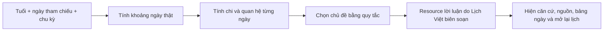

Với ngày/tháng/năm, chủ đề dựa trên quan hệ giữa tuổi và chi anchor: hợp/đồng nhóm → hợp tác; đối xung → rà soát; cùng chi → củng cố; còn lại → cân bằng. Với tuần, engine kiểm tra có ngày thuận và ngày đối xung hay không để chọn chủ đề hỗn hợp hoặc các chủ đề tương ứng.

Các gợi ý công việc/giao tiếp là văn bản biên tập của Lịch Việt theo chủ đề. Kết quả được tính xác định, không dùng số ngẫu nhiên, điểm may mắn hoặc API sinh nội dung. Nguồn được dẫn là nguồn cho bảng quan hệ, tên gọi và quy tắc, **không phải tác giả của bài dự báo ngày cụ thể**.

Rule-set văn hóa mang ID **`lichviet-cultural-1.1-v1`**, bản biên tập **`branch-reflection-v1`**, ngày rà soát nguồn **23/10/2026**. Những ID này giúp xác định nội dung nào đã tạo ra kết quả nếu cần thay đổi quy tắc sau này.

### 13.5. Nguồn và giao diện

`CulturalSources` chứa tiêu đề nguồn, URL và mục tham chiếu. `CulturalSourceCard` mở dialog có phạm vi sử dụng nguồn, rule ID, thời điểm rà soát và URL có thể chọn/copy; mở liên kết bằng ứng dụng ngoài. Phần giải thích có sẵn offline, còn đọc website nguồn cần kết nối của trình duyệt.

Các nhóm nguồn đã ghi trong dự án gồm International Dunhuang Programme/British Library cho biểu tượng, VietnamPlus cho đặc điểm con giáp Việt, *Tam Mệnh Thông Hội* cho nạp âm/quan hệ, Hong Kong Observatory cho Can Chi giờ và *Hiệp Kỷ Biện Phương Thư* cho phương vị/giờ. Không đóng gói ảnh bảo tàng, bản dịch dài hoặc feed dự báo của bên thứ ba.

Dashboard có thể chọn trực tiếp một tuổi hoặc nhập ngày sinh. Ngày sinh tra nhanh và lựa chọn chu kỳ nằm trong saveable UI state; chúng không tự tạo hồ sơ Room. Khi mở bảng từng ngày, chạm một dòng sẽ chọn ngày đó trong lịch chính.

Chi tiết nguồn và công thức: [ZODIAC_FENG_SHUI_RULES_1.1.md](ZODIAC_FENG_SHUI_RULES_1.1.md).

<a id="phong-thuy"></a>
## 14. Các công cụ phong thủy

### 14.1. Quan hệ ngũ hành hai tuổi

Mỗi đầu vào là ngày sinh dương hợp lệ, được chuyển thành năm âm và nạp âm bằng `birthFacts`. Engine so sánh hành nạp âm theo vòng sinh Mộc → Hỏa → Thổ → Kim → Thủy → Mộc. Kết quả có hướng: cùng hành, bên thứ nhất sinh bên thứ hai, được bên thứ hai sinh, khắc hoặc bị khắc.

UI trình bày rõ thứ tự hai người và thông tin can-chi/nạp âm. Không tạo một tỷ lệ “hợp nhau” tổng hợp từ các quan hệ này và không suy kết quả sức khỏe, hôn nhân hay tài sản.

### 14.2. Can Chi giờ

`hourPillar` dùng giờ dân dụng UTC+7 theo quy ước công cụ. Với chỉ số chi giờ:

```text
branch = ((hour + 1) / 2) mod 12
stem   = ((dayStem mod 5) × 2 + branch) mod 10
```

Phép chia trong công thức là chia nguyên. Người dùng chọn đổi ngày lúc 00:00 hoặc coi 23:00–23:59 là ngày kế tiếp; engine tính lại can ngày hiệu lực rồi mới suy can giờ và cờ hoàng đạo. Nếu lựa chọn khiến ngày hiệu lực vượt 31/12/2100, đầu vào bị từ chối thay vì đọc vượt dải.

Một ngày dân dụng được biểu diễn thành **13 đoạn**: Tý 00–01, mười một đoạn 01–03 đến 21–23, rồi Tý 23–24. Hai phần Tý được tách để không gộp nhầm can ngày ở hai đầu ngày. Bảng bao phủ 1.440 phút và dùng chung sáu chi giờ hoàng đạo của calendar engine.

### 14.3. 24 Sơn và tọa/hướng

Người dùng nhập góc mặt tiền thủ công. UI chấp nhận số trong 0–360 độ và kiểm tra lỗi nhập; engine chuẩn hóa vòng 360 và có thể xử lý góc hữu hạn theo modulo. Công cụ không lấy GPS, cảm biến la bàn hoặc tự hiệu chỉnh độ lệch từ.

Với Bắc/Tý ở 0 độ, tăng theo chiều kim đồng hồ:

```text
normalized = ((degrees mod 360) + 360) mod 360
mountain   = floor((normalized + 7.5) / 15) mod 24
trigram    = floor((normalized + 22.5) / 45) mod 8
sitting    = facing + 180 độ, rồi chuẩn hóa
```

Mỗi sơn rộng 15 độ, mỗi quái rộng 45 độ. Khoảng góc lấy biên dưới và loại biên trên; các mốc 7,5/22,5 độ được kiểm thử. Bảng hành là **chính ngũ hành của 24 Sơn** được công bố, tách với các bảng Hồng Phạm hoặc song sơn khác.

### 14.4. Đại Du Niên/Bát Trạch

Trạch quái của nhà lấy theo **tọa**, tức hướng đối diện mặt tiền. Các quái được mã hóa ba hào, hào dưới ở bit 0. Engine XOR mã quái tọa với mã quái phương để xác định sao:

| XOR | Sao |
| --- | --- |
| 0 | Phục Vị |
| 4 | Sinh Khí |
| 3 | Thiên Y |
| 7 | Diên Niên |
| 1 | Họa Hại |
| 6 | Ngũ Quỷ |
| 5 | Lục Sát |
| 2 | Tuyệt Mệnh |

Ví dụ mặt tiền 180 độ là hướng Ngọ, tọa Tý/Khảm; phương Bắc có Phục Vị trong bộ quy tắc này. Engine trả đủ tám phương. Các nhãn cát/hung là thuật ngữ truyền thống được kèm phạm vi và nguồn; công cụ hiện không tính cung phi người ở hoặc chấm điểm thiết kế căn nhà thực tế.

Canvas Compose vẽ sơ đồ phương vị theo kết quả; bảng chữ cung cấp thông tin cùng tên gọi. Toàn bộ phép tính chạy offline và không thay đổi schema dữ liệu.

<a id="widget"></a>
## 15. Widget Android

Widget dùng `AppWidgetProvider` và **RemoteViews XML**, không dùng Compose Glance. Bốn provider kế thừa `CalendarWidgetProvider` và dùng chung `CalendarWidgets.render`:

| Provider | Nội dung |
| --- | --- |
| `TodayWidgetProvider` | Ngày hôm nay, ngày âm/Can Chi và lễ hoặc thứ |
| `LunarWidgetProvider` | Ngày âm lớn, tháng/cờ nhuận, năm Can Chi |
| `MonthWidgetProvider` | Lưới tháng với ngày dương, ngày âm, trạng thái ngày và dấu sự kiện |
| `UpcomingWidgetProvider` | Tối đa bốn sự kiện sắp tới/đang diễn ra, cùng occurrence engine của ứng dụng |

Work `calendar-widget-daily` có chu kỳ một ngày, initial delay hướng tới nửa đêm kế tiếp theo vùng Việt Nam; WorkManager không bảo đảm chạy đúng một thời điểm tuyệt đối. Các mutation sự kiện, thay đổi cài đặt liên quan, đổi locale, widget resize và broadcast hệ thống đều có thể yêu cầu một unique work cập nhật ngay.

`updateAll` đọc các widget ID đã đăng ký; nếu không có widget thì trả sớm, tránh truy vấn dữ liệu không cần thiết. Khi có widget, nó đọc sự kiện và preferences rồi render. Chạm widget tạo PendingIntent chứa ngày được chọn; Activity sử dụng ngày đó trong lịch chính.

Widget sắp tới ưu tiên sự kiện đang kéo dài qua thời điểm hiện tại hoặc occurrence tiếp theo, dùng title/giờ đã giải quyết của ngoại lệ ICS. Widget tháng đánh dấu ngày từ dữ liệu sự kiện. Locale context được áp dụng riêng khi render để widget giữ ngôn ngữ ứng dụng dù không có Activity đang mở.

<a id="sao-luu"></a>
## 16. Sao lưu, khôi phục và xóa dữ liệu

### 16.1. Định dạng JSON

Backup hiện dùng `format = lich-viet-backup`, `version = 5`. Payload gồm các sự kiện, danh sách reminder offsets, cài đặt được hỗ trợ và hồ sơ lá số. Mã ID nội bộ có thể được tạo lại khi restore; các thời điểm alarm/claim/snooze không được sao chép nguyên trạng như một lịch Android đang chạy.

Ngôn ngữ và trạng thái onboarding được quản lý riêng trên thiết bị, không thuộc tập preferences được trao đổi trong JSON. Backup không tự được tải lên; người dùng chọn URI lưu/mở qua SAF. Nhà cung cấp tài liệu được người dùng chọn có thể là ổ cục bộ hoặc ứng dụng lưu trữ khác.

| Validation | Ngưỡng/hành vi |
| --- | --- |
| Tổng văn bản | Tối đa 20.000.000 ký tự |
| Sự kiện | Tối đa 10.000 trong tệp |
| Hồ sơ | Tối đa 1.000 trong tệp |
| Mốc nhắc | Tối đa 16/sự kiện, giá trị phút hợp lệ và không trùng |
| Kiểu JSON | Kiểm tra string, boolean, số nguyên hữu hạn; không tự chấp nhận chuỗi thay số |
| UID | Không trùng trong bản sao lưu |
| Canonical ICS | Parse/preview kiểm tra lại, đúng một UID tương ứng |
| Hồ sơ lá số | Validation ngày/giờ/cờ nhuận/offset/quy tắc trước khi nhận |

### 16.2. Tương thích các phiên bản

Codec đọc v1–v5. Dữ liệu cũ thiếu các trường mới được điền mặc định theo phiên bản. Backup v1 suy mốc phút từ `reminderDaysBefore`; các bản sau đọc danh sách mốc. Hồ sơ bắt đầu được trao đổi ở backup v4; v5 thêm các lựa chọn cài đặt mới. Backup trước v4 không có hồ sơ sẽ giữ hồ sơ hiện tại khi restore.

### 16.3. Luồng khôi phục

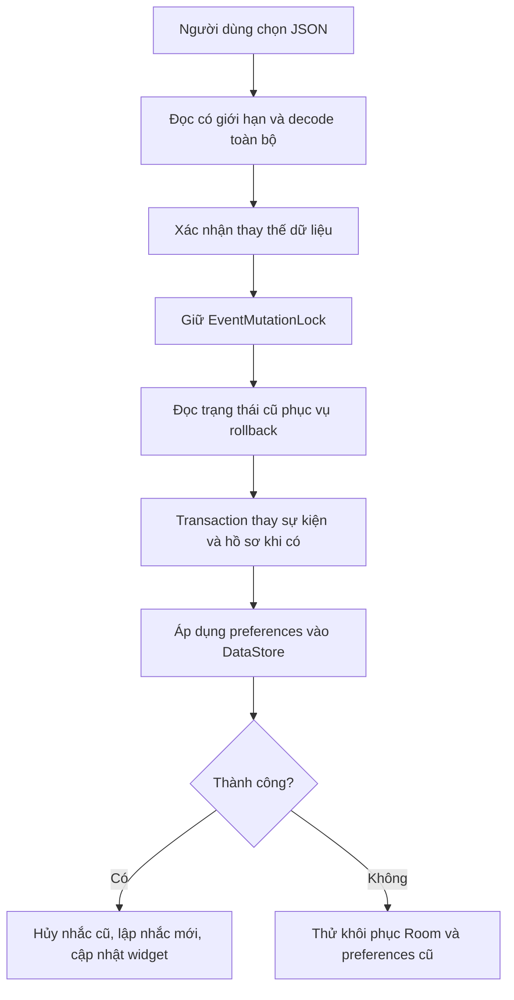

Các ghi nhiều bảng trong Room có transaction. Room và DataStore là hai kho riêng; code có snapshot và best-effort rollback nếu ghi settings lỗi, nhưng không bảo đảm nguyên tử xuyên hai kho khi mất nguồn/process chết giữa các bước. Alarm được hủy/tạo sau khi dữ liệu cần thiết đã được áp dụng.

Xóa toàn bộ dữ liệu cũng dùng mutex: xóa sự kiện/hồ sơ trong transaction, hủy alarm/notification, reset settings và yêu cầu widget render lại. UI có xác nhận cho các thao tác thay thế hoặc xóa dữ liệu.

<a id="bao-mat"></a>
## 17. Bảo mật, quyền và dữ liệu cá nhân

### 17.1. Ranh giới lưu trữ và chia sẻ

Room và DataStore nằm trong bộ nhớ riêng của ứng dụng. Dự án chưa dùng SQLCipher hoặc một lớp mã hóa database riêng; khả năng bảo vệ khi lưu phụ thuộc sandbox ứng dụng và cơ chế bảo mật của thiết bị. JSON, ICS và PNG/PDF sau khi người dùng xuất là các tài liệu có thể đọc được bằng ứng dụng phù hợp.

Manifest đặt `allowBackup=false`; `data_extraction_rules.xml` loại các domain dữ liệu khỏi cloud backup và device transfer theo cấu hình khai báo. Tính năng backup JSON chủ động vẫn hoạt động. Cơ chế khai báo này không thay thế việc kiểm chứng hành vi trên mọi OEM.

FileProvider chỉ công bố hai thư mục cache `ics/` và `horoscope/`, `exported=false`, bật URI grants. Ứng dụng nhận được quyền truy cập theo URI khi người dùng chia sẻ. SAF cho phép chọn file mà không xin quyền truy cập toàn bộ bộ nhớ dùng chung.

### 17.2. Quyền trong manifest nguồn và manifest đã merge

Ba quyền được khai báo trực tiếp trong [AndroidManifest.xml](../app/src/main/AndroidManifest.xml):

| Quyền | Lý do | Cách xử lý |
| --- | --- | --- |
| `POST_NOTIFICATIONS` | Hiển thị lời nhắc trên Android có runtime permission tương ứng | Yêu cầu trong luồng nhắc; kiểm tra trước khi phát |
| `RECEIVE_BOOT_COMPLETED` | Dựng lại lịch nhắc sau reboot | Receiver yêu cầu worker đối soát |
| `SCHEDULE_EXACT_ALARM` | Cho phép mốc nhắc chính xác khi có special access | Kiểm tra quyền; có fallback inexact |

Manifest release đã merge trong kết quả build còn có quyền từ AndroidX/WorkManager như `WAKE_LOCK`, `ACCESS_NETWORK_STATE`, `FOREGROUND_SERVICE` và quyền signature nội bộ `vn.lichviet.app.DYNAMIC_RECEIVER_NOT_EXPORTED_PERMISSION`. Vì vậy không nên mô tả APK là “chỉ có ba quyền”. `ACCESS_NETWORK_STATE` cho phép đọc trạng thái mạng, không đồng nghĩa cấp quyền mở kết nối Internet.

Manifest release được khảo sát **không có `INTERNET`**. Dự án không có HTTP client/API forecast ở luồng nghiệp vụ đang mô tả. Khi người dùng bấm một nguồn, trình duyệt ngoài ứng dụng có thể truy cập web bằng quyền của trình duyệt. Quyền từ dependency nên được kiểm tra lại trên merged manifest mỗi lần nâng thư viện.

### 17.3. Thành phần nhận dữ liệu từ bên ngoài

`MainActivity` được export cho launcher và mở MIME ICS; URI/extra từ bên ngoài được parse và kiểm tra. Dữ liệu ICS đi qua preview trước khi commit. Receiver lời nhắc và widget cùng FileProvider không export như một API công khai của ứng dụng. PendingIntent lời nhắc dùng immutable flag và URI định danh riêng.

Các biện pháp giới hạn kích thước, kiểm tra ngày/enum/UID/recurrence/timezone giảm khả năng nhận dữ liệu sai hoặc làm việc quá mức. Đây là các kiểm tra cụ thể trong mã, chưa phải kết quả của một đợt pentest hoặc fuzzing độc lập.

### 17.4. Dữ liệu nhạy cảm trong chức năng lá số

Ngày giờ sinh, biệt danh, quan hệ nhóm và dữ liệu sự kiện có thể mang tính cá nhân. Ứng dụng lưu đầu vào tại máy và chỉ xuất/chia sẻ theo thao tác người dùng. File export có thể chứa những thông tin này; sau khi chia sẻ, phạm vi truy cập phụ thuộc ứng dụng đích và nơi lưu mà người dùng chọn.

Không có cơ chế tài khoản, xác thực máy chủ hoặc phân quyền nhiều người dùng trong cùng database ứng dụng. Nếu phát triển đồng bộ sau này, đó sẽ là một thay đổi kiến trúc và mô hình dữ liệu riêng.

<a id="hieu-nang"></a>
## 18. Hiệu năng, bất đồng bộ và xử lý lỗi

### 18.1. Các biện pháp đã có

| Vùng | Cách tối ưu/điều phối | Ý nghĩa |
| --- | --- | --- |
| Khởi tạo lịch | Lazy bảng tháng; `warmUp` trên Default | Tránh dựng lại toàn bộ bảng tháng mỗi lần chọn ngày |
| Dữ liệu ngày | LRU 512 entry, thread-safe, cache ID | Tái sử dụng kết quả và không gắn cache vào ngôn ngữ |
| Đổi dương → âm | Binary search bảng tháng | Tìm nhanh tháng chứa ngày |
| Cửa sổ lịch | Chỉ mở rộng 7/42 ngày đang hiển thị | Giảm số occurrence cần cho một màn |
| Tính toán UI | `produceState` + Default cho occurrence/dự báo; `mapLatest` cho chart | Tránh phần tính toán này chiếm main thread và giảm kết quả cũ |
| File/database | IO dispatcher tại repository và các luồng đọc/ghi file | Tách công việc I/O khỏi vẽ UI |
| Trạng thái | Flow theo lifecycle, `remember`/saveable | Hạn chế công việc không cần thiết và giữ trạng thái qua recreation |
| Ghi dữ liệu | Room transaction và mutex chung | Tránh sửa sự kiện, import, restore và nhắc đọc/ghi chồng nhau |
| Công việc nền | Unique work, KEEP/REPLACE theo nhiệm vụ | Hạn chế xếp nhiều job tương đương |
| Widget | Kiểm tra widget đăng ký trước khi đọc dữ liệu | Không render khi không có nơi hiển thị |
| Release | R8 và resource shrinking | Thu gọn mã/resource của gói phát hành |
| Cache export | Dọn file cũ ở lần xuất sau | Hạn chế tăng bộ nhớ cache lâu dài theo thao tác sử dụng |

### 18.2. Quy mô xử lý theo triển khai hiện tại

Gọi `M` là số tháng trong bảng thiên văn, `E` là số sự kiện lưu, `K` là số occurrence trong cửa sổ, `D` là số ngày đang xét:

| Thao tác | Đặc điểm từ thuật toán hiện có |
| --- | --- |
| `solarToLunar` | Tìm tháng khoảng `O(log M)` sau khởi tạo |
| `lunarToSolar` | Tìm tuyến tính tháng khoảng `O(M)`; có thể lập index nếu cần |
| Tìm ngày theo khoảng | Duyệt `D`, mỗi ngày đánh giá lịch và quy tắc; `D ≤ 367` |
| Forecast tháng/năm | Duyệt tìm biên và tạo từng ngày thực; dải một tháng/năm, có giới hạn 1900–2100 |
| Quan hệ chi/ngũ hành, phương vị | Bảng hữu hạn và modulo/XOR, chi phí nhỏ cố định |
| Layout tuần | Sort các occurrence rồi tìm lane; mặc định ít lane, nhưng bước quét lane có thể tăng khi chồng lấp nhiều |
| Lịch sự kiện | DAO đang phát toàn bộ sự kiện; engine lọc/mở rộng cho cửa sổ, chưa có paging/index truy vấn riêng theo recurrence |
| Đối soát nhắc | Duyệt các sự kiện và từng reminder row; phụ thuộc số lượng sự kiện và độ phức tạp ICS |
| Backup | Đọc/parse snapshot trong RAM; có ngưỡng kích thước và số lượng |

Các mô tả độ phức tạp là suy ra từ cấu trúc mã, không phải kết quả benchmark. Riêng parse/mở rộng ICS có chi phí theo biểu thức recurrence và ngoại lệ; ngưỡng đầu vào không tự chứng minh mọi tệp hợp lệ đều xử lý nhanh trên thiết bị yếu.

### 18.3. Ranh giới transaction và đồng thời

`EventMutationLock` là mutex trong một tiến trình, phối hợp ghi sự kiện, reminder, hồ sơ và backup. Các giao dịch Room bảo vệ những thay đổi nhiều bảng. Các thao tác Android như hủy notification, enqueue work hoặc tạo alarm không cùng transaction SQLite; trạng thái bền và reconciliation giúp đồng bộ lại.

`NonCancellable` được dùng tại các đoạn cần hoàn tất sau khi đã bắt đầu mutation. Cách này phù hợp các tác vụ ngắn để tránh hủy ở bước không nhất quán, nhưng các thao tác restore lớn vẫn có thể giữ khóa lâu. Nếu mở rộng tới dữ liệu lớn hoặc đa tiến trình, cần thiết kế lại phạm vi khóa, tiến độ và cơ chế phục hồi.

### 18.4. Chính sách lỗi

Các lỗi đầu vào được kiểm tra trước khi ghi. Editor/ICS/export có trạng thái busy và resource lỗi; phần tính occurrence trả trạng thái rỗng kèm thông báo khi không thể xử lý. Worker đối soát trả retry khi lỗi. `BroadcastReceiver` kết thúc `PendingResult` trong `finally` để không giữ broadcast vô hạn.

UI loading/error, validation có kiểu và kiểm tra lại dữ liệu sau thao tác ngoài app giúp tránh hiển thị thành công khi tác vụ chưa xong. Dự án hiện chưa có hệ thống crash reporting từ xa hoặc telemetry đo hiệu năng trong sản phẩm; log kiểm tra QA và báo cáo test được giữ ở môi trường phát triển.

<a id="kiem-thu"></a>
## 19. Kiểm thử và mức kiểm chứng

### 19.1. Bằng chứng sử dụng trong báo cáo

Đọc lại các XML trong [artifacts/reports/v1.1.0](../artifacts/reports/v1.1.0) cho kết quả dưới đây. Các lần chạy bổ sung là tập con chạy lại, không cộng vào số lượng test duy nhất để tạo một tổng lớn hơn.

| Nhóm | Số test | Kết quả |
| --- | ---: | --- |
| JVM core | 41 | 0 failure, 0 error |
| JVM app | 32 | 0 failure, 0 error |
| Tổng JVM duy nhất | **73** | Đạt trong bộ báo cáo đã lưu |
| Android full suite — phone API 37 | **45** | 0 failure, 0 error |
| Chạy lại hành trình con giáp — phone | 3 | Đạt; tập con sau chỉnh hiển thị |
| Nhóm con giáp — tablet API 37 | 4 | Đạt; 3 hành trình + 1 English |
| Lint debug | 0 lỗi, **76 cảnh báo** | Chưa giải quyết hết cảnh báo |

Môi trường phone được ghi nhận: 1080×2400, density 420, API 37. Môi trường tablet được giả lập bằng override 1600×1000, density 200 trên emulator API 37. Bốn bài tablet là một tập con, không phải toàn bộ 45 bài Android.

### 19.2. Chi tiết JVM

| Module | Test class | Số bài | Nội dung chính |
| --- | --- | ---: | --- |
| core | `VietnameseCalendarTest` | 12 | Chuyển đổi, Can Chi, lễ, biên và quy tắc lịch |
| core | `AstronomicalFixturesTest` | 3 | Fixture thiên văn/lịch độc lập và các sai khác UTC+7/UTC+8 |
| core | `CalendarRelease101Test` | 3 | Bổ sung 1.0.1, ngày lễ và logic lịch liên quan |
| core | `HoroscopeChartEngineTest` | 9 | Quy tắc an cung/sao, Cục, Tứ Hóa, chu kỳ, input và tháng nhuận |
| core | `ZodiacEngineTest` | 9 | Đủ 12 tuổi, nạp âm, hợp/xung, Tết, biến thể năm và bốn chu kỳ |
| core | `FengShuiEngineTest` | 5 | Can Chi giờ, đổi ngày, đủ đoạn giờ, biên góc 24 Sơn và ma trận 8×8 |
| app | `RecurrenceTest` | 8 | Lặp native, ngày thiếu, tháng nhuận, mốc tìm tiếp |
| app | `HoroscopeProfileValidationTest` | 5 | Dữ liệu hồ sơ và quy tắc đầu vào |
| app | `EventLayoutEngineTest` | 2 | Thanh nhiều ngày/lane/overflow |
| app | `IcsCodecTest` | 10 | Parse/export, recurrence, extension và trường hợp bị từ chối |
| app | `ReminderPlannerTest` | 7 | Tính mốc nhắc, offset, lần tiếp theo và quy ước thời gian |

Một bài JUnit có thể chứa nhiều fixture hoặc vòng lặp dữ liệu. Ví dụ kiểm thử chuyển đổi bao quát 73.414 ngày dương hỗ trợ trong 1900–2100; số ngày này không được gọi là 73.414 test case độc lập.

### 19.3. Kiểm thử Android

Instrumentation/Compose tests kiểm tra persistence và migration Room, delivery claim, backup codec, alarm integration, nhập/xuất ICS ở runtime, editor sự kiện, nhiều mốc nhắc, onboarding, locale, điều hướng, widget, hồ sơ lá số và chart export.

Nhóm 1.1.0 bổ sung các hành trình chọn tuổi Mèo, nhập ngày trước Tết, chọn bốn chu kỳ, phân biệt tháng nhuận, mở nguồn, giữ state qua recreation/tab, mở ngày dự báo trong lịch và nhập góc phương vị không hợp lệ/hợp lệ. Bài English kiểm tra resource thực đang hiển thị. Các selector mới sử dụng semantics/test tag để chọn đúng nút nguồn của forecast.

### 19.4. Fixture độc lập và phạm vi kết luận

| Miền | Bằng chứng | Giới hạn kết luận |
| --- | --- | --- |
| Lịch | Roundtrip toàn dải; fixture NASA/HKO và trường hợp lịch Việt khác UTC+8 | Roundtrip tự thân chỉ chứng minh tính nhất quán; fixture bên ngoài mới hỗ trợ đối chiếu độc lập |
| Thiên văn | 25 sóc 2026–2027 so bảng UT làm tròn phút; chênh lớn nhất ghi nhận 29,081 giây | Không suy thành sai số tối đa cho toàn bộ 1900–2100 |
| Đông chí | Fixture 1984 ghi chênh khoảng 5,994 phút nhưng đúng ngày dân dụng Việt Nam | Không dùng engine gọn này như dịch vụ giờ chuyển tiết chính xác |
| Lá số | Fixture nguồn từng phần, bảng Tử Vi/Tứ Hóa và quy tắc theo ấn bản | Chưa có full-chart golden độc lập đầy đủ |
| Con giáp | Ca quanh Tết, đủ quan hệ/bảng nạp âm, chu kỳ và tính xác định | Test thuật toán không kiểm chứng khả năng dự đoán tương lai |
| Bát Trạch | 64 ô theo ma trận độc lập được viết thành fixture; đủ tâm và biên góc | Kiểm tra bảng quy tắc, không kiểm định tác động của nhà thực tế |

### 19.5. Kiểm tra giao diện và release

Đã có ảnh QA được xem trên phone/tablet và một số màn với font 200%, VI/EN, sáng/tối. Release build bật R8/resource shrinking và AAB đã thành công. Bản sao release được ký bằng khóa debug cho QA đã cài, mở lạnh dashboard tablet và thử nhập góc; log được kiểm tra không có AndroidRuntime error ở các thao tác đó.

Chưa có coverage phần trăm được công bố, benchmark FPS/cold start/pin, báo cáo pentest, QA toàn bộ máy thật/OEM, runtime đầy đủ API 26–32 hoặc kiểm định TalkBack/mọi multi-window. Các test và ảnh hiện có cần được đọc đúng theo cấu hình đã chạy.

Ảnh minh họa đã lưu:

- [Dashboard phone](../artifacts/v110-zodiac-phone.png)
- [Chi tiết và dự báo](../artifacts/v110-zodiac-reading-phone.png)
- [Dashboard tablet, bản release R8 dùng QA](../artifacts/v110-release-tablet-zodiac.png)
- [Phone font 200%](../artifacts/v110-phone-font200.png)
- [Tablet font 200%](../artifacts/v110-tablet-font200.png)

<a id="build"></a>
## 20. Build, đóng gói và phát hành

### 20.1. Cấu hình build

`settings.gradle.kts` khai báo hai module, cấm thêm repository ở project con bằng `FAIL_ON_PROJECT_REPOS`. Version plugin được đặt ở root; dependency trực tiếp đặt trong module. Không có version catalog TOML hoặc Gradle dependency lockfile trong cấu hình được khảo sát. Việc ghim dependency trực tiếp và hash Gradle distribution giúp tái lập build, nhưng chưa tương đương một chuỗi cung ứng dependency được khóa/kiểm chứng đầy đủ.

`build.ps1` chọn JDK từ một số đường dẫn phát triển nếu chưa có `JAVA_HOME`, sau đó gọi wrapper. Nếu không truyền task, script chạy core test, app unit test, assembleDebug và lintDebug. Đường dẫn JDK/SDK trong hướng dẫn là môi trường đã dùng; người clone cần cấu hình lại cho máy của mình và lưu ý file daemon JVM local nêu ở mục 2.1.

Các lệnh phục vụ dự án:

```powershell
# Kiểm tra JVM, đóng gói debug và Lint
.\build.ps1

# Kiểm thử Android trên thiết bị/emulator đã kết nối
.\build.ps1 :app:connectedDebugAndroidTest

# Gate tích hợp
.\build.ps1 :core:test :app:testDebugUnitTest :app:lintDebug :app:connectedDebugAndroidTest '-Pandroid.injected.androidTest.leaveApksInstalledAfterRun=true'

# Chạy nhóm con giáp
.\build.ps1 :app:connectedDebugAndroidTest '-Pandroid.testInstrumentationRunnerArguments.package=vn.lichviet.app.zodiac'

# APK và AAB release
.\build.ps1 :app:assembleRelease :app:bundleRelease
```

Các lệnh trên là hướng dẫn tái chạy, không phải các lệnh đã được thực thi lại trong lần chỉ viết báo cáo này. Đường dẫn SDK đặt trong `local.properties`, không đưa vào Git. Môi trường mới cần quyền tải dependency cho lần build đầu; sản phẩm sau cài vẫn vận hành offline theo phạm vi mô tả.

### 20.2. Cấu hình release và gói đầu ra

Release bật `isMinifyEnabled` và `isShrinkResources`, dùng ProGuard optimize mặc định cùng rules riêng. Room/Hilt cung cấp consumer rules. Hai `dontwarn` hiện có phục vụ probe timezone Android của iCal4j và annotation formatting tùy chọn; chúng không có nghĩa bỏ qua mọi cảnh báo R8.

| Gói | Vị trí build mặc định | Mục đích |
| --- | --- | --- |
| Debug APK | `app/build/outputs/apk/debug/app-debug.apk` | Cài thử và phát triển |
| Release APK | `app/build/outputs/apk/release/app-release-unsigned.apk` | Gói tối ưu cần ký bằng khóa phát hành |
| Release AAB | `app/build/outputs/bundle/release/app-release.aab` | Đầu vào phân phối qua cửa hàng sau khi hoàn tất ký/cấu hình phát hành |

Các gói đã lưu của đợt 1.1.0: [debug APK](../artifacts/LichViet-1.1.0-debug.apk), [release APK chưa ký](../artifacts/LichViet-1.1.0-release-unsigned.apk), [AAB](../artifacts/LichViet-1.1.0-release.aab), kèm [SHA256SUMS-1.1.0.txt](../artifacts/SHA256SUMS-1.1.0.txt). Gói QA release ký khóa debug chỉ phục vụ kiểm tra runtime, không thay thế khóa phát hành.

`.gitignore` loại APK/AAB/idsig, keystore, build, local SDK và các tệp môi trường phát triển. Người clone cần tự build hoặc nhận artifact qua kênh phát hành. Tại lần lập báo cáo chưa thấy cấu hình CI được version hóa trong `.github/workflows`; các gate được mô tả là chạy bằng script/wrapper, chưa có bằng chứng pipeline tự động trên máy chủ.

### 20.3. Trạng thái sẵn sàng phát hành

Mã v1.1.0 đã có báo cáo build/test và artifact cục bộ. Hồ sơ phát hành được ghi nhận chưa có production signing, store listing hoặc upload Google Play. Việc chuẩn bị khóa, kiểm tra thiết bị thật, thông tin quyền riêng tư/Data safety và các nội dung cửa hàng là công việc tiếp theo của phát hành; không được suy từ `assembleRelease` thành việc ứng dụng đã lên cửa hàng.

<a id="danh-gia"></a>
## 21. Quyết định thiết kế và đánh đổi

| Quyết định | Lợi ích trong dự án | Đánh đổi/điều kiện bảo trì |
| --- | --- | --- |
| Android native bằng Kotlin/Compose | Dùng trực tiếp lifecycle, AlarmManager, widget, SAF và accessibility semantics | Cần QA theo phiên bản Android và thiết bị |
| Core Kotlin thuần | Quy tắc dùng chung, dễ test JVM và tách UI | Một số nghiệp vụ recurrence/ICS vẫn ở module app |
| Sinh bảng tháng từ thiên văn | Không phụ thuộc API hoặc bảng tải sẵn; xử lý UTC+7 rõ | Chi phí khởi tạo và giới hạn mô hình thiên văn phải được kiểm chứng |
| Typed ID trước resource | Dịch VI/EN và cache độc lập ngôn ngữ | Cần giữ mapping đầy đủ khi thêm enum |
| Room lưu đầu vào lá số | Tránh lưu chart lỗi thời, dễ tính lại theo quy tắc | Cần chính sách nâng rule-set trong tương lai |
| Canonical ICS theo UID | Giữ nhiều thông tin và ngoại lệ để xuất lại | Parse/mở rộng phức tạp hơn, tốn bộ nhớ với chuỗi lớn |
| Occurrence engine dùng chung | Lịch/widget/nhắc nhất quán về instance | Một lỗi engine có phạm vi ảnh hưởng rộng nên test hồi quy quan trọng |
| Stable reminder ID + claim | Giảm giao trùng và hủy đúng mốc | Cần đối soát với hệ điều hành, không thể có transaction SQLite–notification chung |
| Mutex dùng chung | Đơn giản hóa phối hợp mutation và restore | Restore/import lớn có thể chặn thao tác ghi khác trong cùng tiến trình |
| Không có tài khoản/backend | Dữ liệu tại máy, không cần vận hành server | Không tự đồng bộ/khôi phục sang máy khác nếu người dùng chưa xuất backup |
| Nội dung văn hóa có rule ID và nguồn | Truy vết phép tính, phân biệt bảng quy tắc với lời biên tập | Cần quản lý hiệu đính, cách dịch và nguồn khi nâng cấp |
| RemoteViews widget | Tương thích AppWidget framework và cấu trúc hiện tại | UI/widget có công nghệ render khác nhau nên phải QA riêng |

Ở quy mô hiện tại, cách chia hai module giữ dự án tương đối dễ theo dõi. Nếu thêm đồng bộ, nhiều nguồn dự báo hoặc khối lượng sự kiện lớn, cần cân nhắc tách domain/service rõ hơn thay vì để ViewModel và repository hiện tại tiếp nhận mọi trách nhiệm mới.

<a id="huong-phat-trien"></a>
## 22. Giới hạn và hướng phát triển

### 22.1. Giới hạn đã xác định

| Miền | Phần còn giới hạn |
| --- | --- |
| Lịch sử lịch pháp | Trước 1968 dùng UTC+7 hồi tố; không tái dựng lịch từng miền |
| Thiên văn | Chưa cung cấp thời điểm chuyển tiết chính xác cao |
| Ngày lễ | Không tính lịch nghỉ bù pháp lý từng năm |
| Nhắc nền | Chịu quyền, Doze, force-stop, máy tắt và hành vi OEM |
| ICS | Tập recurrence/VALARM/timezone được hỗ trợ có giới hạn; chưa chỉnh ngoại lệ, chưa CalDAV |
| Restore | Không có atomic transaction xuyên Room–DataStore–Android alarm |
| Lá số | Chưa full-chart golden, brightness, đầy đủ phụ tinh hoặc luận đoán chuyên sâu |
| Phong thủy | Chưa nhị thập bát tú, Huyền Không phi tinh, Kỳ Môn, cung phi người ở |
| La bàn | Nhập góc thủ công; không sensor calibration hoặc magnetic declination |
| Hiệu năng | Chưa có benchmark pin/FPS/cold start/large-data định lượng |
| Bảo mật | Chưa có kiểm toán bảo mật, fuzzing hoặc database encryption riêng |
| Chất lượng thiết bị | Chưa QA đầy đủ API thấp, máy thật/OEM, TalkBack và mọi kích thước cửa sổ |
| Phát hành | Đợt artifact được mô tả chưa production-signed và chưa đưa lên cửa hàng |

### 22.2. Đề xuất ưu tiên cho giai đoạn tiếp theo

Những mục sau là đề xuất kỹ thuật, chưa phải chức năng đã có hoặc cam kết lịch thực hiện.

| Ưu tiên | Hạng mục | Kết quả cần chứng minh |
| --- | --- | --- |
| Cao | Chốt môi trường JVM/toolchain và cấu hình CI | Clone sạch chạy được gate; lưu XML/artifact/mapping theo version |
| Cao | QA máy thật API thấp và OEM phổ biến | Có ma trận thiết bị, quyền nhắc, reboot/Doze/force-stop và giới hạn được ghi nhận |
| Cao | Kiểm tra accessibility và chữ lớn toàn hành trình | TalkBack đọc hợp lý; nhập/lưu/khôi phục/tra cứu không bị mất thao tác |
| Cao | Hoàn tất signing và quy trình phát hành | Khóa bảo quản ngoài repo, gói kiểm chứng chữ ký, quy trình rollback/update rõ |
| Trung bình | Đo baseline hiệu năng trước tối ưu | Có cold start, jank, RAM và thời gian mở rộng ICS trên bộ dữ liệu quy định |
| Trung bình | Xử lý cảnh báo Lint theo ảnh hưởng | Giảm cảnh báo có giá trị mà không tắt rule hàng loạt |
| Trung bình | Index/paging hoặc chiến lược truy vấn occurrence | Đo được cải thiện với nhiều sự kiện; không làm sai recurrence/ngoại lệ |
| Trung bình | Giảm phạm vi khóa cho import/restore lớn | Tính nhất quán được giữ, UI có tiến độ và hành vi hủy được định nghĩa |
| Trung bình | Khóa/kiểm chứng dependency và SBOM | Theo dõi dependency bắc cầu, license và thay đổi manifest |
| Theo nhu cầu sản phẩm | Nâng cấp thư viện có kiểm thử hồi quy | Build/test, minSdk, R8 và các quy tắc ICS còn đúng sau nâng cấp |
| Theo nguồn đủ tin cậy | Mở rộng rule-set Tử Vi/phong thủy | Công thức, source edition, fixture độc lập và migration quy tắc trước khi thêm lời luận |
| Theo nhu cầu sản phẩm | Đồng bộ nhiều thiết bị | Thiết kế tài khoản, mã hóa, conflict/UID và quyền riêng tư riêng trước triển khai |

Không nên thêm dự báo ngẫu nhiên hoặc chấm điểm tổng hợp chỉ để làm đầy nội dung. Với tính năng có nguồn, cần giữ phân biệt đầu vào, bảng/công thức, diễn giải của ứng dụng và phần nguồn chưa đủ để kết luận.

<a id="tham-chieu"></a>
## 23. Chỉ mục mã nguồn và tài liệu

### 23.1. Điểm vào khi tiếp nhận dự án

| Cần tìm hiểu | Đọc từ |
| --- | --- |
| Build và dependency | [Root Gradle](../build.gradle.kts), [app Gradle](../app/build.gradle.kts), [core Gradle](../core/build.gradle.kts), [settings](../settings.gradle.kts) |
| Khởi động | [LichVietApplication.kt](../app/src/main/java/vn/lichviet/app/LichVietApplication.kt), [MainActivity.kt](../app/src/main/java/vn/lichviet/app/MainActivity.kt) |
| State/điều hướng | [CalendarViewModel.kt](../app/src/main/java/vn/lichviet/app/CalendarViewModel.kt), [App.kt](../app/src/main/java/vn/lichviet/app/ui/App.kt) |
| Lưu trữ | [AppDatabase.kt](../app/src/main/java/vn/lichviet/app/data/AppDatabase.kt), [EventRepository.kt](../app/src/main/java/vn/lichviet/app/data/EventRepository.kt) |
| Preferences/locale | [PreferencesRepository.kt](../app/src/main/java/vn/lichviet/app/data/PreferencesRepository.kt), [AppLocaleManager.kt](../app/src/main/java/vn/lichviet/app/AppLocaleManager.kt) |
| Lịch âm | [Astronomy.kt](../core/src/main/kotlin/vn/lichviet/core/Astronomy.kt), [VietnameseCalendar.kt](../core/src/main/kotlin/vn/lichviet/core/VietnameseCalendar.kt) |
| Ngày tốt | [Almanac.kt](../core/src/main/kotlin/vn/lichviet/core/Almanac.kt) |
| Lặp/occurrence | [Recurrence.kt](../app/src/main/java/vn/lichviet/app/data/Recurrence.kt), [EventOccurrenceEngine.kt](../app/src/main/java/vn/lichviet/app/ics/EventOccurrenceEngine.kt) |
| Bố trí nhiều ngày | [EventLayoutEngine.kt](../app/src/main/java/vn/lichviet/app/ics/EventLayoutEngine.kt), [CalendarScreen.kt](../app/src/main/java/vn/lichviet/app/ui/CalendarScreen.kt) |
| Lời nhắc | [ReminderScheduler.kt](../app/src/main/java/vn/lichviet/app/reminder/ReminderScheduler.kt), [AlarmReminderScheduler.kt](../app/src/main/java/vn/lichviet/app/reminder/AlarmReminderScheduler.kt), [ReminderReceiver.kt](../app/src/main/java/vn/lichviet/app/reminder/ReminderReceiver.kt) |
| ICS | [IcsCodec.kt](../app/src/main/java/vn/lichviet/app/ics/IcsCodec.kt), [IcsSupport.kt](../app/src/main/java/vn/lichviet/app/ics/IcsSupport.kt), [IcsRepository.kt](../app/src/main/java/vn/lichviet/app/ics/IcsRepository.kt) |
| Lá số core | [HoroscopeModels.kt](../core/src/main/kotlin/vn/lichviet/core/horoscope/HoroscopeModels.kt), [HoroscopeChartEngine.kt](../core/src/main/kotlin/vn/lichviet/core/horoscope/HoroscopeChartEngine.kt) |
| Hồ sơ/export | [HoroscopeViewModel.kt](../app/src/main/java/vn/lichviet/app/horoscope/HoroscopeViewModel.kt), [ChartExporter.kt](../app/src/main/java/vn/lichviet/app/horoscope/ChartExporter.kt) |
| Con giáp/phong thủy core | [ZodiacEngine.kt](../core/src/main/kotlin/vn/lichviet/core/zodiac/ZodiacEngine.kt), [FengShuiEngine.kt](../core/src/main/kotlin/vn/lichviet/core/zodiac/FengShuiEngine.kt), [CulturalSources.kt](../core/src/main/kotlin/vn/lichviet/core/zodiac/CulturalSources.kt) |
| Con giáp/phong thủy UI | [ZodiacWorkspace.kt](../app/src/main/java/vn/lichviet/app/zodiac/ZodiacWorkspace.kt), [FengShuiWorkspace.kt](../app/src/main/java/vn/lichviet/app/zodiac/FengShuiWorkspace.kt), [CulturalSourceCard.kt](../app/src/main/java/vn/lichviet/app/zodiac/CulturalSourceCard.kt) |
| Widget | [CalendarWidgets.kt](../app/src/main/java/vn/lichviet/app/widget/CalendarWidgets.kt) |
| Backup | [BackupRepository.kt](../app/src/main/java/vn/lichviet/app/data/BackupRepository.kt) |
| Quyền/chia sẻ | [Manifest](../app/src/main/AndroidManifest.xml), [data extraction rules](../app/src/main/res/xml/data_extraction_rules.xml), [FileProvider paths](../app/src/main/res/xml/ics_file_paths.xml) |

### 23.2. Tài liệu chi tiết và bằng chứng

| Tài liệu | Nội dung |
| --- | --- |
| [README](../README.md) | Tổng quan, mở/build, tính năng, dependency |
| [VALIDATION](../VALIDATION.md) | Lịch sử các đợt kiểm chứng |
| [RELEASE_1.1.0](RELEASE_1.1.0.md) | Phạm vi và kết quả bàn giao phiên bản đang mô tả |
| [Core README](../core/README.md) | Chuẩn thời gian, mô hình thiên văn, fixture và nguồn lịch |
| [Horoscope rules](../core/HOROSCOPE_RULES.md) | Ấn bản Tử Vi, phép an, hiệu đính và giới hạn |
| [Zodiac/feng shui rules 1.1](ZODIAC_FENG_SHUI_RULES_1.1.md) | Bảng nguồn, công thức và ranh giới lời biên tập |
| [Phase 1 reminders](PHASE1_REMINDERS.md) | Thiết kế lời nhắc đáng tin cậy |
| [Phase 2 advanced calendar](PHASE2_ADVANCED_CALENDAR.md) | Lặp/ICS/nhiều ngày và tập tương thích |
| [Phase 3 onboarding/i18n](PHASE3_ONBOARDING_I18N.md) | Onboarding và đa ngôn ngữ |
| [Phase 4 horoscope](PHASE4_HOROSCOPE.md) | Hồ sơ, lá số và xuất tài liệu |
| [Audit 1.0.1](REQUIREMENTS_AUDIT_1.0.1.md) | Đối chiếu yêu cầu ở mốc lịch sử 1.0.1; đọc cùng phần cập nhật 1.1 |
| [Third-party notices](../THIRD_PARTY_NOTICES.md) | License và attribution |
| [XML/summary v1.1.0](../artifacts/reports/v1.1.0) | Kết quả test/lint đã lưu dùng làm bằng chứng |

Nguồn bên ngoài cho công thức và nội dung văn hóa được dẫn tại các tài liệu quy tắc nói trên. Báo cáo kỹ thuật này đối chiếu cách mã nguồn áp dụng các nguồn đã ghi trong dự án; không bổ sung một đợt thẩm định lịch pháp hoặc bản quyền độc lập mới.

<a id="thuat-ngu"></a>
## 24. Thuật ngữ

| Thuật ngữ | Nghĩa trong dự án |
| --- | --- |
| Native Android | Giao diện và tích hợp hệ thống Android bằng Kotlin/Compose/API nền tảng |
| MVVM | UI quan sát trạng thái ViewModel; ViewModel phối hợp dữ liệu và thao tác |
| Flow / StateFlow | Luồng phát thay đổi dữ liệu; StateFlow luôn có giá trị trạng thái hiện tại |
| Repository | Lớp điều phối truy cập dữ liệu và nghiệp vụ lưu trữ |
| DAO | Giao diện truy vấn/ghi database do Room sinh phần triển khai |
| Transaction | Nhóm thao tác database cùng thành công hoặc rollback |
| Mutex | Khóa bất đồng bộ để các tác vụ cùng tiến trình không đi vào vùng ghi đồng thời |
| Migration | Biến đổi schema/dữ liệu khi nâng phiên bản database |
| Recurrence | Quy tắc lặp của một sự kiện |
| Occurrence | Một lần xuất hiện cụ thể sau khi áp dụng quy tắc lặp và ngoại lệ |
| UID | Định danh ổn định của chuỗi iCalendar, khác ID số của Room |
| Canonical ICS | Bản iCalendar được parse/serialize để giữ một chuỗi UID cùng thông tin liên quan |
| `[start, end)` | Khoảng bao gồm bắt đầu, loại trừ kết thúc |
| Exact/inexact alarm | Alarm chính xác khi được cấp quyền hoặc alarm có thể bị hệ thống trì hoãn |
| Reconciliation | Đối soát dữ liệu lưu bền với trạng thái alarm/job cần có |
| SAF | Storage Access Framework: chọn URI file qua giao diện hệ thống |
| R8 | Công cụ tối ưu, thu gọn và làm rối mã release |
| Rule-set | Bộ công thức/bảng và quy ước có ID để truy vết kết quả |
| Fixture/golden | Dữ liệu kỳ vọng để kiểm thử; golden độc lập cần căn cứ bên ngoài thuật toán đang kiểm tra |
| Nạp âm | Một trong 30 tên/hành gắn với từng cặp của vòng 60 can-chi |
| Tọa/hướng | Phía tựa và phía mặt tiền đối diện nhau trong công cụ phương vị |


